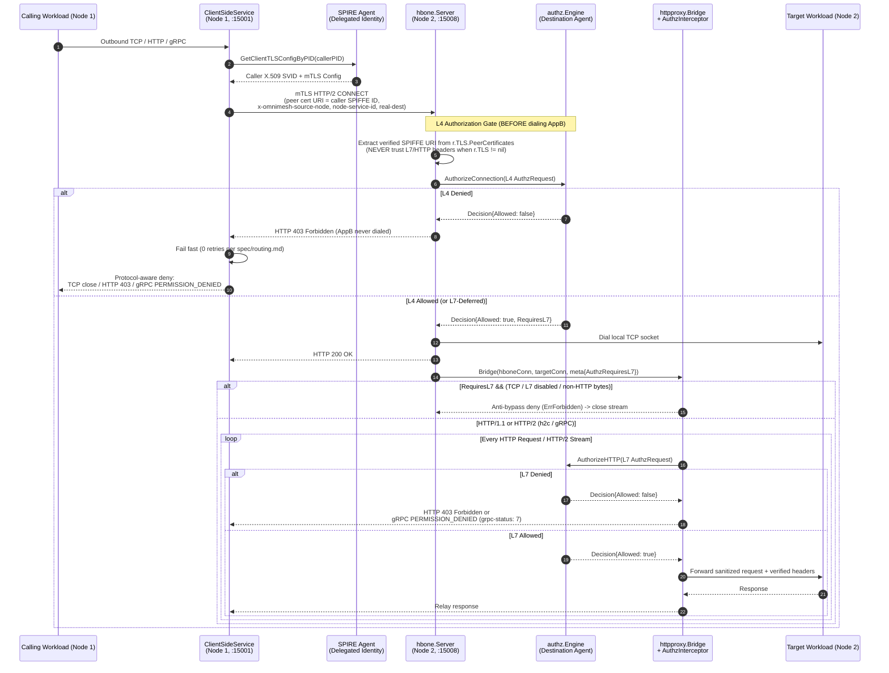
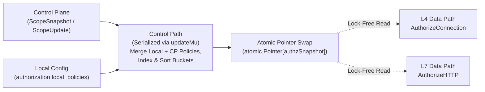

# Data Plane Authorization Specification

## 1. Introduction & Core Security Principles

This document specifies how **OmniMeshDP** evaluates and enforces service-to-service authorization across the mesh data plane (`internal/application/authz`, `internal/adapter/inbound/hbone`, `internal/application/httpproxy`, `internal/application/proxy`, and `internal/application/orchestrator`), aligning **omnimeshcontrol**'s RFCs (specifically RFC-0001, RFC-0003, RFC-0004, RFC-0005, and RFC-0006) with the live `omnimesh.v1` `AgentService.AgentStream` gRPC contract.

### Core Principles

1. **Zero Trust, Default-Deny Posture**: No service-to-service communication is permitted unless explicitly authorized by an `ALLOW` policy (or permitted by a same-namespace `open` isolation policy) and not blocked by any `DENY` policy (RFC-0004 §3).
2. **Cryptographic SPIFFE Identity First**: Authorization decisions rely on cryptographically verified caller SPIFFE IDs (`spiffe://<trust-domain>/ns/<namespace>/sa/<service-name>`) extracted from the mTLS peer X.509 SVID presented during HBONE connection establishment — never network IP addresses or untrusted L7 headers.
3. **Destination-Side Enforcement**: Authorization is enforced at the **destination agent** (server side), at the exact boundary where mTLS terminates (`hbone.Server` for L4 and `httpproxy.Bridge` for L7). The source agent establishes mTLS using the calling workload's delegated SPIRE SVID (`WorkloadSVIDProvider`), proving caller identity to the destination agent.
4. **Layered L4 and L7 Protection**:
   - **L4 Connection Gate (`hbone.Server`)**: Evaluates identity, target service, destination port, and labels *before* dialing the local target workload TCP socket.
   - **L7 Request/Stream Gate (`httpproxy.Bridge` + `AuthzInterceptor`)**: Evaluates HTTP method, normalized path, headers, and gRPC service/method per HTTP/1.1 request and per HTTP/2 / gRPC stream, preventing L4 fallback bypasses and enabling immediate mid-connection policy revocation on persistent connections.
5. **Protocol-Aware Deny Responses**: Denied connections and requests receive protocol-native feedback (`403 Forbidden` for HTTP/1.1 & HTTP/2, gRPC `PERMISSION_DENIED` status code `7` via `Grpc-Status`/`Grpc-Message` trailers for gRPC, immediate connection close for raw TCP), while outbound routing fails fast on peer `403` without retrying other endpoints (`spec/routing.md` §5.3).
6. **Fail-Closed Startup & Resilience**:
   - Before the initial `ScopeSnapshot` arrives (Orchestrator Step 5), the authorization engine initializes immediately in its configured mode (`strict` by default), denying unauthorized traffic rather than failing open.
   - If the control plane stream disconnects, OmniMeshDP retains its last-known-good atomic authorization snapshot uninterrupted (`internal/application/agent/control_plane.go`) and replaces it atomically upon reconnect.

### Reconciling RFC-0004 with the Live `omnimesh.v1` Agent Stream

While RFC-0004 sketches high-level `AuthzPeer` (`SpiffeID`, `Namespace`, `TrustDomain`), `AuthzTarget` (`ServiceID`, `Ports`), L7 `AuthzRule` (`HTTP`, `GRPC`), temporal bounds (`ValidFrom`, `ValidUntil`), and `AuthzDryRun`, the live `omnimesh.v1` protobuf contract (`agent.proto`) currently delivers:

- `AuthzPolicyInfo`: `name`, `namespace`, `action` (`"ALLOW"`, `"DENY"`, or `"DRY_RUN"`), `source` (`SelectorInfo{namespace, name, labels}`), and `destination` (`SelectorInfo{namespace, name, labels}`).
- `NamespaceInfo`: `name`, `cidr`, `subnets`, `isolation` (`"strict"` or `"open"`), and `labels`.
- `ServiceInfo`: `namespace`, `name`, `protocol`, `mesh_addr`, `port`, and `selector_sets`.
- `RouteInfo`: `namespace`, `service_name`, and `target_nodes[]` (`NodeEndpointInfo{node_id, addr, route_name, target, target_address, labels, id}`).

OmniMeshDP bridges both cleanly:
- It ingests all `ScopeSnapshot` and `ScopeUpdate` messages directly from `omnimesh.v1` today without modifying `omnimeshcontrol`.
- Its domain model (`model.AuthzPolicy`) and engine already support the full RFC-0004 feature set (`SpiffeID`, `TrustDomain`, `DestinationPorts`, `HTTPAuthzRule`, `GRPCAuthzRule`, `ValidFrom`/`ValidUntil`, and `DRY_RUN`), usable immediately via local bootstrap/fallback policies (`authorization.local_policies`) and ready for future protobuf extensions.

---

## 2. Control Plane Inputs & Agent Communication

OmniMeshDP receives authorization state over the persistent bidirectional `AgentService.AgentStream` (`omnimeshv1.AgentStreamResponse`):

| Protobuf Message | Key Fields Consumed by Authorization | Role in Data Plane |
|---|---|---|
| `ScopeSnapshot` | `authz_policies`, `namespaces`, `services`, `routes` | Full atomic state replacement at startup (Step 5) and on control plane reconnection. |
| `ScopeUpdate` | `type` (`ADD`, `MODIFY`, `REMOVE`), `authz_policies`, `namespaces`, `services`, `routes` | Incremental differential updates applied during steady state (Step 9). |
| `AuthzPolicyInfo` | `name`, `namespace`, `action`, `source`, `destination` | Service-to-service `ALLOW` / `DENY` / `DRY_RUN` policies scoped to the agent. |
| `SelectorInfo` | `namespace`, `name` (`"*"` or `""` = wildcard), `labels` | Source and destination selectors (AND logic across `labels`). |
| `NamespaceInfo` | `name`, `isolation` (`"strict"` / `"open"`) | Controls intra-namespace default behavior when no explicit `DENY` or `ALLOW` matches. |
| `ServiceInfo` | `namespace`, `name`, `protocol`, `mesh_addr`, `port` | Resolves `(namespace, service_name, protocol)` from `x-omnimesh-real-dest` IP when `x-omnimesh-node-service-id` is absent or local service JSON omits `protocol`. |
| `RouteInfo` | `namespace`, `service_name`, `target_nodes[]` (`node_id`, `labels`) | Supplies source workload labels (`Source.Labels`) indexed by `(namespace, service_name, node_id)` with fallback to `(namespace, service_name)`. |

### Control Plane Lifecycle Guarantees

1. **Step 3 Initialization (Fail-Closed)**: `authz.Engine` is constructed during Orchestrator Step 3 *before* listeners start serving traffic, immediately enforcing `AuthorizationConfig` (`strict` default-deny) and any configured `local_policies`.
2. **Step 5 Initial Snapshot**: Immediately after `RegisterAndGetSnapshot` succeeds, `o.authzEngine.ApplySnapshot(snapshot)` compiles and publishes the initial authorization snapshot alongside `o.router.ApplySnapshot(snapshot)`.
3. **Step 9 Incremental Updates**: Every `ScopeUpdate` received on `StreamUpdates` is forwarded to both `o.router.ApplyUpdate(update)` and `o.authzEngine.ApplyUpdate(update)`.
4. **Reconnect & Disconnect Resilience**: When the gRPC stream disconnects, `ControlPlaneAgent` retains the active snapshot so authorized traffic continues unimpeded and unauthorized traffic remains blocked. On reconnect, `SetSnapshotHandler` invokes `o.authzEngine.ApplySnapshot(newSnapshot)`, replacing any stale control-plane policies that were deleted while disconnected.

---

## 3. End-to-End Architecture & Enforcement Boundaries



### 3.1 Bootstrapping & Mesh-Internal Exclusions

Per RFC-0004 §3.1, infrastructure flows are excluded from workload authorization enforcement because they do not traverse the workload `hbone.Server` tunnel path:
- **Agent ↔ Control Plane** bidirectional gRPC (`ControlPlaneConfig.Address`): authenticated separately via `SpiffeTLSProvider.GetTLSConfig()` authorizing `Spire.ServerSVID`.
- **SPIRE Agent ↔ SPIRE Server** attestation and Workload / Delegated Identity API sockets.
- **CoreDNS ↔ etcd** DNS lookups and infrastructure state reads.
- **Local Active Health Probes** (`internal/application/service/health.go`): executed by the local agent directly against local workload ports without traversing `hbone.Server`.

### 3.2 Anti-Spoofing Trust Boundaries

1. **Authoritative Caller Identity Extraction (`hbone.Server.ServeHTTP`)**:
   - When `r.TLS != nil && len(r.TLS.PeerCertificates) > 0`, `hbone.Server` scans peer certificate `URIs` for a `spiffe://` URI (`uri.Scheme == "spiffe"`), setting `callerVerified = true`.
   - When `r.TLS != nil`, `hbone.Server` **MUST NEVER** fall back to `x-omnimesh-caller-identity` or `x-omnimesh-source-identity` HTTP headers, even if the certificate lacks a SPIFFE URI.
   - Only when mTLS is absent (`r.TLS == nil`, e.g. `spire.disabled == true`) may `hbone.Server` inspect `HeaderCallerIdentity` / `HeaderSourceIdentity` with `callerVerified = false`.
2. **Unverified Identity Gate**:
   - By default (`spire.disabled == false`), `allow_unverified_identity` resolves to `false`: unverified callers (`CallerVerified == false`) are rejected under `strict` mode (`AuthzReasonUnauthenticated`) and cannot bypass authorization via forged headers.
   - When `spire.disabled == true` and `allow_unverified_identity` is omitted (`nil`), it defaults to `true` for local/test deployments unless explicitly overridden (`allow_unverified_identity: false` or `AUTHZ_ALLOW_UNVERIFIED_IDENTITY=false`).
3. **Trust Domain Boundary**:
   - When `Engine` has a configured `trustDomain` (from `AuthorizationConfig.TrustDomain`, `SpireConfig.TrustDomain`, or parsed from `SpireConfig.ServerSVID`), selectors without an explicit `TrustDomain` or `SpiffeID` only match identities belonging to the local trust domain. Identities from foreign trust domains require explicit `TrustDomain` or `SpiffeID` policy rules.

---

## 4. Control Path vs. Data Path Engine (`internal/application/authz`)

Mirroring `internal/application/proxy/router.go` (`spec/routing.md` §3), the authorization engine strictly separates **control-path compilation** from **lock-free data-path evaluation**:



### 4.1 Control Path (Slow Path)

- `ApplySnapshot`, `ApplyUpdate`, and `SetLocalPolicies` are serialized under `updateMu`.
- Raw state (`cpPolicies`, `localPolicies`, `namespaces`, `servicesByIP`, `servicesByID`, `routes`) is updated on a cloned/replacement working copy.
- Before publishing, `compileSnapshotLocked` builds an immutable `*authzSnapshot`:
  1. **Action-Partitioned, Destination-Indexed Buckets**: Policies are partitioned by action (`deny`, `allow`, `dryRun`) and indexed into:
     - `exactDest map[serviceKey][]*compiledPolicy` — O(1) lookup for policies targeting a specific `(namespace, serviceName)`.
     - `nsWildcardDest map[string][]*compiledPolicy` — O(1) lookup for policies targeting `(namespace, "*")` or `(namespace, "")`.
     - `globalWildcardDest []*compiledPolicy` — policies targeting `("*", "*")` or `("", "*")`.
  2. **Deterministic Ordering**: Policies within each bucket are sorted lexicographically by `(Namespace, Name)` so decision metadata (`MatchedPolicy`) and evaluation logs are deterministic across all nodes.
  3. **Pre-Normalized Predicates**: HTTP methods are uppercased, HTTP header names are canonicalized via `http.CanonicalHeaderKey`, and L7 paths/gRPC targets are pre-trimmed at compile time.
  4. **Service & Label Indices**:
     - `servicesByIP` and `servicesByID` map `MeshAddr` and `(namespace, name)` to normalized protocol metadata.
     - `sourceLabelsByNode` and `sourceLabelsBySvc` index `RouteInfo.TargetNodes` labels for evaluating `Source.Labels` selectors.
     - `namespaceIsolation` maps namespace names to `strict` or `open`.
- Once compiled, `e.snapshot.Store(newSnapshot)` publishes the snapshot atomically.

### 4.2 Data Path (Hot Path)

- `AuthorizeConnection` and `AuthorizeHTTP` load the snapshot via a single lock-free `e.snapshot.Load()`.
- Evaluation inspects at most the 3 destination-relevant slices (`exactDest[destKey]`, `nsWildcardDest[destNS]`, `globalWildcardDest`) per action tier, avoiding full policy table scans.
- Metrics counters (`AuthzStats`) use lock-free `atomic.Uint64` increments.

---

## 5. Identity Parsing, Selector Matching & Evaluation Algorithm

### 5.1 SPIFFE Identity Parsing (`model.ParseSPIFFEIdentity`)

Canonical workload URI format:

```text
spiffe://<trust-domain>/ns/<namespace>/sa/<service-name>
```

Parsing rules:
1. Must begin with `"spiffe://"` and contain no `?` or `#` components.
2. `<trust-domain>` must be non-empty and consist only of lowercase ASCII SPIFFE trust-domain characters (`[a-z0-9._-]`).
3. Path segments must not contain empty segments, `"."`, or `".."`.
4. If the path consists of exactly 4 segments `["ns", namespace, "sa", serviceName]` with non-empty `namespace` and `serviceName`, `IsWorkload = true`, `Namespace = namespace`, and `ServiceName = serviceName`.
5. Other valid SPIFFE URIs (e.g., node/agent SVIDs `spiffe://omnimesh.local/spire/agent/...`) parse with `IsWorkload = false`, `Namespace = ""`, `ServiceName = ""`, and can still match `SpiffeID`, `TrustDomain`, or wildcard (`Namespace: "*", Name: "*"`) selectors.

### 5.2 Selector Matching Semantics

For a policy `P` to match a request `(caller, dest)`:

1. **Temporal Window (RFC-0004 §6.4)**:
   - Evaluated using `now := e.nowFn()` (`time.Now()` by default).
   - If `P.ValidFrom != nil && now.Before(*P.ValidFrom)`, `P` is inactive (skipped).
   - If `P.ValidUntil != nil && !now.Before(*P.ValidUntil)`, `P` is expired (skipped).
2. **Source Selector (`P.Source`)**:
   - **Identity**:
     - If `SpiffeID != ""`: `caller.Raw == SpiffeID`.
     - Else if `TrustDomain != ""`: `caller.TrustDomain == TrustDomain`.
     - Else if `engine.trustDomain != ""`: `caller.TrustDomain == engine.trustDomain`.
   - **Namespace & Name**:
     - If `Namespace != "" && Namespace != "*"`: requires `caller.IsWorkload && caller.Namespace == Namespace`.
     - If `Name != "" && Name != "*"`: requires `caller.IsWorkload && caller.ServiceName == Name`.
   - **Source Labels (`Source.Labels`)**:
     - If non-empty: every `(k, v)` must match simultaneously (AND logic) against `req.SourceLabels` (if provided) or against a workload endpoint's `Labels` in `sourceLabelsByNode[{caller.Namespace, caller.ServiceName, req.SourceNodeID}]` (falling back to `sourceLabelsBySvc[{caller.Namespace, caller.ServiceName}]`). If no endpoint label set matches (or labels are unknown), the source selector does **not** match (fail-closed).
3. **Destination Selector (`P.Destination`) & Ports**:
   - **Namespace & Name**: `""` or `"*"` matches any; otherwise exact equality with resolved `(DestNamespace, DestServiceName)`.
   - **Destination Labels (`Destination.Labels`)**: every `(k, v)` must match `req.DestLabels` (AND logic).
   - **Destination Ports (`P.DestinationPorts`)**: if non-empty, `req.DestPort` must be in the list (`req.DestPort > 0`).

### 5.3 Evaluation Precedence & Mode Truth Table

Evaluation executes in the following strict order:

1. **Global Disabled Mode**: If `mode == "disabled"`, return `Allowed: true, Reason: AuthzReasonDisabled`.
2. **Identity Verification & Parsing**:
   - If `!req.CallerVerified && !allowUnverified`: classify as `AuthzReasonUnauthenticated` and apply mode posture (below).
   - Else parse `callerID, ok := model.ParseSPIFFEIdentity(req.CallerIdentity)`: if `!ok`, classify as `AuthzReasonInvalidIdentity` and apply mode posture (below).
3. **Explicit `DENY` Policies (Highest Priority)**:
   - Evaluate matching `DENY` policies in `(Namespace, Name)` order.
   - At **L4**:
     - Any matching L4-only `DENY` policy (no L7 `Rules`) immediately denies (`ReasonExplicitDeny`) — or records `WouldDeny` under global `dry_run`.
     - Any matching L7-scoped `DENY` policy sets `hasMatchingL7Deny = true` so L7 inspection is forced on the connection.
   - At **L7**:
     - Any matching `DENY` policy (whose L7 `Rules` match if present, or L4-only) immediately denies (`ReasonExplicitDeny`) — or records `WouldDeny` under global `dry_run`.
4. **Explicit `ALLOW` Policies**:
   - Evaluate matching `ALLOW` policies in `(Namespace, Name)` order.
   - At **L4**:
     - An L4-only `ALLOW` matches immediately (`RequiresL7 = hasMatchingL7Deny`). If `hasMatchingL7Deny` is true and L7 enforcement is unavailable (`!req.InboundL7Available` or target protocol is `tcp`), fail closed with `ReasonL7Required`.
     - An L7-scoped `ALLOW` matches at L4 **only** if `req.InboundL7Available && effectiveProto != "tcp"`, returning `Allowed: true, RequiresL7: true, Reason: AuthzReasonExplicitAllowL7Deferred`. If the target service is `tcp` or inbound L7 is disabled, it is denied fail-closed (`ReasonL7Required`).
   - At **L7**:
     - An `ALLOW` policy matches if its L4 selectors match AND (it has no L7 `Rules`, OR at least one rule in `Rules` matches the HTTP/gRPC attributes).
     - If an L4-matching `ALLOW` policy exists with L7 rules that did not match, record `l7Mismatch = true`.
5. **Namespace Isolation (`open` vs `strict`)**:
   - If no explicit `ALLOW` matched, check the destination namespace's isolation mode (`NamespaceInfo.Isolation`, falling back to `AuthorizationConfig.NamespaceDefaultIsolation`, default `"strict"`).
   - If isolation is `"open"`, AND `callerID.IsWorkload`, AND `callerID.Namespace == destNamespace`, AND (`engine.trustDomain == ""` || `callerID.TrustDomain == engine.trustDomain`):
     - Traffic is allowed (`AuthzReasonNamespaceOpen`), with `RequiresL7 = hasMatchingL7Deny` (still enforcing L7 `DENY` policies; fail-closed with `ReasonL7Required` if `hasMatchingL7Deny` and L7 is unavailable).
   - Cross-namespace traffic is **never** permitted by `NamespaceIsolationOpen`.
6. **Policy-Level `DRY_RUN` Policies**:
   - Evaluated if no `ALLOW` / `open` isolation granted access, logging `AuthzReasonDryRunPolicy`.
7. **Default Posture by Global Mode**:

| Evaluation Outcome | `strict` (Default) | `permissive` | `dry_run` | `disabled` |
|---|---|---|---|---|
| Unverified / Invalid Identity | **DENY** (`unauthenticated` / `invalid_identity`) | **ALLOW** (`permissive_default`) | **ALLOW** (`dry_run=true, would_deny=true`) | **ALLOW** (`disabled`) |
| Explicit `DENY` Matched | **DENY** (`explicit_deny`) | **DENY** (`explicit_deny`) | **ALLOW** (`dry_run=true, would_deny=true`) | **ALLOW** (`disabled`) |
| Explicit `ALLOW` Matched | **ALLOW** (`explicit_allow`) | **ALLOW** (`explicit_allow`) | **ALLOW** (`explicit_allow`) | **ALLOW** (`disabled`) |
| Same-NS `open` Isolation | **ALLOW** (`namespace_open`) | **ALLOW** (`namespace_open`) | **ALLOW** (`namespace_open`) | **ALLOW** (`disabled`) |
| Policy `DRY_RUN` Matched | **ALLOW** (`dry_run=true, dry_run_policy`) | **ALLOW** (`dry_run=true, dry_run_policy`) | **ALLOW** (`dry_run=true, dry_run_policy`) | **ALLOW** (`disabled`) |
| No Policy Matched | **DENY** (`no_policy` / `l7_mismatch` / `l7_required`) | **ALLOW** (`permissive_default`) | **ALLOW** (`dry_run=true, would_deny=true`) | **ALLOW** (`disabled`) |

---

## 6. L4 vs. L7 Enforcement, L7 Rules & Anti-Bypass Guard

### 6.1 L7 Rule Matching (`HTTPAuthzRule` & `GRPCAuthzRule`)

Within a policy's `Rules []AuthzRule`:
- Multiple `AuthzRule` entries are **OR-ed**; fields within a single `HTTPAuthzRule` or `GRPCAuthzRule` are **AND-ed**.
- **`HTTPAuthzRule`**:
  - `Methods`: case-insensitive match (empty = all methods).
  - `PathExact` & `PathPrefixes`:
    - Target path is normalized before matching using `path.Clean` to prevent path-traversal bypasses such as `/api/v1/public/../admin` matching `/api/v1/public` (preserving trailing-slash semantics when the cleaned path represents a directory).
    - If both `PathExact` and `PathPrefixes` are empty, all paths match. If either is non-empty, the normalized path must satisfy at least one exact match or prefix match.
  - `Headers`: every `(k, v)` entry must equal `req.Headers.Get(k)` (case-insensitive header name lookup).
- **`GRPCAuthzRule`**:
  - Requires `req.IsGRPC == true` (`Content-Type` starts with `application/grpc`, case-insensitive).
  - `GRPCService` and `GRPCMethod` are parsed from the HTTP/2 `:path` (`/{service}/{method}`).
  - `Services`: exact match (or `"*"`; empty = all services).
  - `Methods`: exact match (or `"*"`; empty = all methods).

### 6.2 L4-to-L7 Deferral & Anti-Bypass Invariant

When an L4 connection is allowed solely because of an L7-scoped `ALLOW` policy (or when an L7-scoped `DENY` policy exists for the caller→destination pair), `AuthzDecision.RequiresL7` is set to `true` and propagated into `ConnectionMeta.AuthzRequiresL7`.

**Anti-Bypass Rule in `httpproxy.Bridge.Bridge`**:
If `meta.AuthzRequiresL7 == true`, the bridge **MUST NEVER** take raw L4 passthrough (`bridgeL4`):
- If inbound HTTP L7 inspection is disabled, or `meta.ConfiguredProto == ProtocolTCP`, or byte sniffing detects non-HTTP/TLS/timeout bytes (`meta.DetectedProto == ProtocolTCP`), `Bridge` immediately rejects with `domain.ErrForbidden`, logs `authz.denied` (`reason=l7_required`), and closes both connections without copying a single application byte to the target workload.

### 6.3 Mid-Connection Revocation

For persistent HTTP/1.1 keep-alive connections and multiplexed HTTP/2 / gRPC streams, `AuthzInterceptor.OnRequest` queries `authorizer.AuthorizeHTTP` on **every individual HTTP request or HTTP/2 stream**. When `ScopeUpdate` adds an emergency `DENY` policy or removes an `ALLOW` policy, subsequent requests on already-open connections are immediately denied with `403 Forbidden` or gRPC `PERMISSION_DENIED`.

### 6.4 Protocol-Aware Deny Responses & Outbound Fail-Fast

| Target Protocol | Inbound Rejection (`hbone.Server` / `httpproxy.Bridge`) | Outbound Client Experience (`ClientSideService` + `RespondForbidden`) |
|---|---|---|
| **TCP** | `hbone.Server` returns HTTP `403` on HBONE `CONNECT`; target workload is never dialed. | Closes `localConn` immediately with **0 retries** (`spec/routing.md` §5.3). |
| **HTTP/1.1** | L4: `hbone.Server` returns `403` on `CONNECT`. L7: `httpproxy.Bridge` writes `HTTP/1.1 403 Forbidden` with `Connection: close`. | On L4 `403`, `RespondForbidden` sniffs HTTP/1.1 and sends `HTTP/1.1 403 Forbidden` (`Connection: close`) to the caller before closing `localConn`. On L7 `403`, relays the inbound `403` response directly. |
| **HTTP/2 (`h2c`)** | L4: `403` on `CONNECT`. L7: `httpproxy.Bridge` writes HTTP/2 `403 Forbidden`. | On L4 `403`, `RespondForbidden` serves HTTP/2 `403 Forbidden` on `localConn` then shuts down cleanly. |
| **gRPC (`h2c`)** | L4: `403` on `CONNECT`. L7: `AuthzInterceptor` returns `HTTP 200`, `Content-Type: application/grpc`, and trailing `Grpc-Status: 7` / `Grpc-Message: permission denied` (`OmitBody: true`). | On L4 `403`, `RespondForbidden` inspects `Content-Type: application/grpc` (or `RawProtocol == "grpc"`) and responds with `HTTP 200`, `Content-Type: application/grpc`, and trailing `Grpc-Status: 7` (`PERMISSION_DENIED`) so standard gRPC clients decode `codes.PermissionDenied`. |

---

## 7. Domain Models, Ports & Configuration Surface

### 7.1 `AppConfig.Authorization` JSON Schema & Env Overrides

```json
{
  "authorization": {
    "mode": "strict",
    "namespace_default_isolation": "strict",
    "allow_unverified_identity": false,
    "enforce_l7": true,
    "trust_domain": "omnimesh.local",
    "audit_log_allows": false,
    "local_policies": []
  }
}
```

| Field | Env Override | Default | Validation |
|---|---|---|---|
| `authorization.mode` | `AUTHZ_MODE` | `"strict"` | One of `"strict"`, `"permissive"`, `"dry_run"`, `"disabled"`. |
| `authorization.namespace_default_isolation` | `AUTHZ_NAMESPACE_DEFAULT_ISOLATION` | `"strict"` | One of `"strict"`, `"open"`. |
| `authorization.allow_unverified_identity` | `AUTHZ_ALLOW_UNVERIFIED_IDENTITY` | `false` *(auto `true` when `spire.disabled == true` unless explicitly set)* | Optional boolean (`*bool`). |
| `authorization.enforce_l7` | `AUTHZ_ENFORCE_L7` | `true` | Boolean. |
| `authorization.trust_domain` | `AUTHZ_TRUST_DOMAIN` | `""` *(falls back to `spire.trust_domain` or `spire.server_svid` trust domain)* | Empty or valid SPIFFE trust domain (`[a-z0-9._-]+`). |
| `authorization.audit_log_allows` | `AUTHZ_AUDIT_LOG_ALLOWS` | `false` | Boolean. |
| `authorization.local_policies` | — | `[]` | Valid action (`allow`/`deny`/`dry_run`), valid ports `1..65535`, valid RFC 3339 timestamps (`valid_from <= valid_until`), valid HTTP header names. |

### 7.2 Ports (`internal/port/inbound/authz.go` & `http_proxy.go`)

```go
type Authorizer interface {
    AuthorizeConnection(ctx context.Context, req model.AuthzRequest) model.AuthzDecision
    AuthorizeHTTP(ctx context.Context, req model.AuthzRequest) model.AuthzDecision
}

type AuthzPolicyUpdater interface {
    ApplySnapshot(snapshot *omnimeshv1.ScopeSnapshot)
    ApplyUpdate(update *omnimeshv1.ScopeUpdate)
}

type AuthzDecisionObserver interface {
    OnAuthzDecision(ctx context.Context, req model.AuthzRequest, decision model.AuthzDecision)
}

type HTTPForbiddenResponder interface {
    RespondForbidden(ctx context.Context, downstream net.Conn, meta model.ConnectionMeta) error
}
```

---

## 8. Observability & Audit Logging (RFC-0005 Alignment)

Every authorization decision updates lock-free atomic counters (`Engine.Stats()`) matching RFC-0005 §5.9:
- `AllowedTotal`, `DeniedTotal`, `DryRunWouldDenyTotal`, `PermissiveAllowTotal`
- Denial breakdown: `DeniedNoPolicyTotal`, `DeniedExplicitTotal`, `DeniedL7MismatchTotal`, `DeniedUnauthenticatedTotal`, `DeniedL7RequiredTotal`
- Cached policy count: `PoliciesCached`

Structured audit logs emit machine-parseable fields (correlating with `trace_id` and `request_id` at L7):
- `authz.denied` (always logged on denial)
- `authz.dry_run.would_deny` (logged in `dry_run` mode or when a `DRY_RUN` policy matches)
- `authz.permissive.allow` (logged when `permissive` mode allows otherwise-unauthorized traffic)
- `authz.allowed` (logged only when `authorization.audit_log_allows == true`)

An optional `inbound.AuthzDecisionObserver` hook (configurable via `orchestrator.WithAuthzObserver`) enables future OpenTelemetry metrics/span adapters without adding OTel dependencies into the domain or application layers.

---

## 9. Component Mapping & Verification Plan

| File | Responsibility |
|---|---|
| [`internal/domain/errors.go`](../internal/domain/errors.go) | `ErrForbidden`, `ErrInvalidAuthzConfig`, `ErrUnauthorized`; `TunnelStatusError.Is(ErrForbidden)`; `HTTPRejectError.OmitBody`. |
| [`internal/domain/model/authz.go`](../internal/domain/model/authz.go) | SPIFFE URI parser, `AuthzPolicy`, `AuthorizationConfig`, `AuthzRequest`, `AuthzDecision`, `AuthzStats`, validation. |
| [`internal/domain/model/http_headers.go`](../internal/domain/model/http_headers.go) | Extend `ConnectionMeta` with `RawProtocol`, `DestPort`, and `AuthzRequiresL7`. |
| [`internal/domain/model/app_config.go`](../internal/domain/model/app_config.go) | Add `Authorization` config, defaults, `AUTHZ_*` env overrides, validation. |
| [`internal/port/inbound/authz.go`](../internal/port/inbound/authz.go) | `Authorizer`, `AuthzPolicyUpdater`, `AuthzDecisionObserver` ports. |
| [`internal/port/inbound/http_proxy.go`](../internal/port/inbound/http_proxy.go) | `HTTPForbiddenResponder` optional interface. |
| [`internal/application/authz/engine.go`](../internal/application/authz/engine.go) | Lock-free snapshot-compiled L4/L7 authorization evaluator, `ScopeSnapshot`/`ScopeUpdate` ingestion, metrics, audit logs. |
| [`internal/application/httpproxy/interceptor_authz.go`](../internal/application/httpproxy/interceptor_authz.go) | Per-request/per-stream L7 `AuthzInterceptor` and gRPC `PERMISSION_DENIED` formatting. |
| [`internal/application/httpproxy/bridge.go`](../internal/application/httpproxy/bridge.go) | `SetAuthorizer`, anti-bypass `AuthzRequiresL7` guard, `OmitBody` support, `RespondForbidden`. |
| [`internal/adapter/inbound/hbone/server.go`](../internal/adapter/inbound/hbone/server.go) | Hardened mTLS SPIFFE extraction, L4 `AuthorizeConnection` gate before local dial, `ConnectionMeta` enrichment. |
| [`internal/application/proxy/server.go`](../internal/application/proxy/server.go) | Expose `SetAuthorizer` on `ServerSideService`. |
| [`internal/application/proxy/client.go`](../internal/application/proxy/client.go) | Protocol-aware `RespondForbidden` on peer `403` in `ClientSideService`. |
| [`internal/application/orchestrator/orchestrator.go`](../internal/application/orchestrator/orchestrator.go) | Build `authz.Engine`, wire to `ServerSideService` & `httpBridge`, sync snapshots and streaming updates. |

### Verification Coverage

1. Unit tests for SPIFFE URI parsing, `AuthorizationConfig` validation, and `AUTHZ_*` environment overrides.
2. `authz.Engine` unit tests covering default-deny, `ALLOW` / `DENY` precedence, wildcards, namespace `open` vs `strict` isolation, source/destination labels, trust-domain anti-spoofing, unverified identity gating, all 4 modes, temporal policies, HTTP/gRPC L7 rules with path traversal rejection, L4 deferral, `ScopeSnapshot`/`ScopeUpdate` lifecycle, `-race` concurrency, and benchmarks (`BenchmarkAuthorizeConnection`, `BenchmarkAuthorizeHTTP`).
3. `httpproxy` tests for `AuthzInterceptor` (HTTP/1.1, HTTP/2, gRPC Trailers-Only `PERMISSION_DENIED`), `AuthzRequiresL7` L4 bypass rejection, and `RespondForbidden`.
4. `hbone` mTLS tests verifying denied callers never trigger a local backend dial and cannot spoof `x-omnimesh-caller-identity`.
5. End-to-end integration tests across `ClientSideService` → HBONE mTLS → `ServerSideService` + `httpproxy.Bridge` + `authz.Engine` (TCP, HTTP/1.1 keep-alive mid-connection revocation, gRPC `codes.PermissionDenied`, and L4 bypass prevention).
6. `Orchestrator` tests verifying startup snapshot, reconnect snapshot, streaming updates, and invalid authz config fail-fast.
