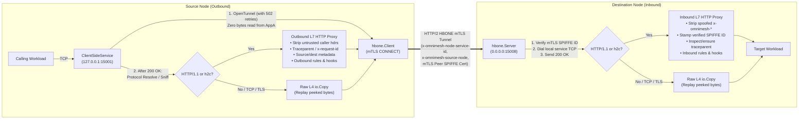
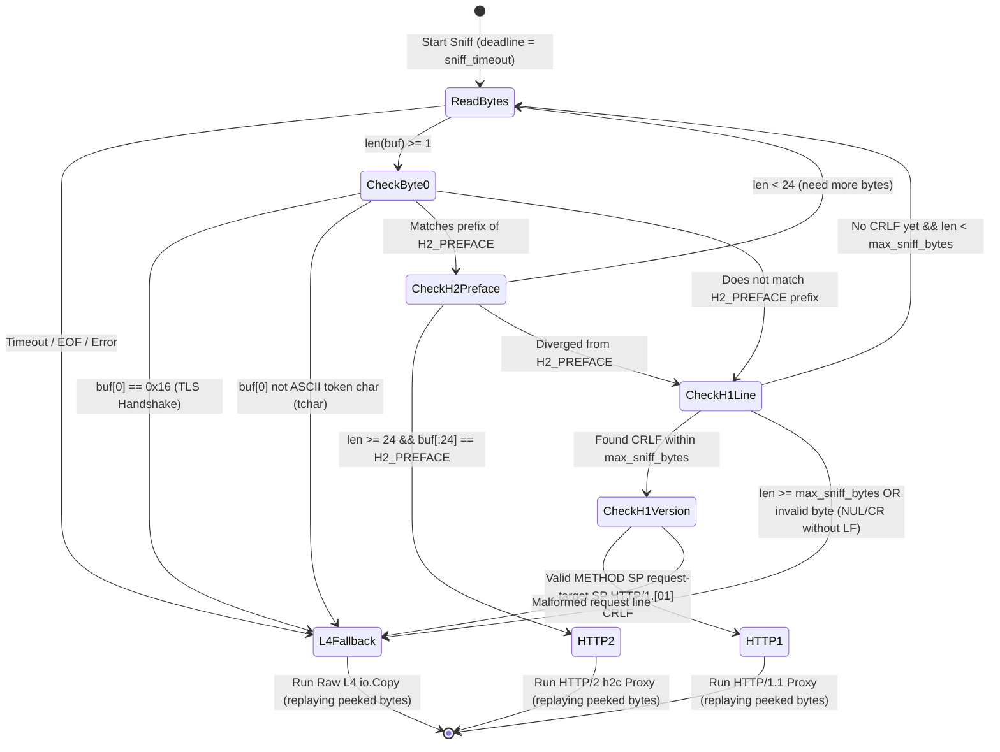
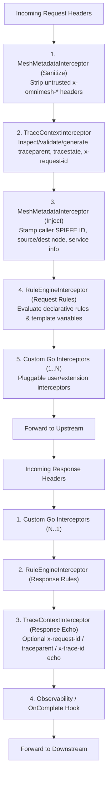

# HTTP/1.1 & HTTP/2 Header Inspection and Injection Specification

## 1. Introduction

This document specifies how **OmniMeshDP** inspects and mutates HTTP/1.1 and HTTP/2 (`h2c`) request and response headers on intercepted mesh connections, while transparently preserving raw L4 TCP passthrough for non-HTTP and application-TLS traffic.

Today, OmniMeshDP operates as an L4 transparent TCP proxy over an HTTP/2 HBONE (`CONNECT`) mTLS overlay:
- **Outbound (`ClientSideService`)** accepts intercepted TCP connections on `127.0.0.1:15001`, resolves routing via `Router`, opens an HBONE `CONNECT` tunnel via `hbone.Client`, and copies raw bytes bidirectionally.
- **Inbound (`ServerSideService` / `hbone.Server`)** terminates the peer mTLS HBONE `CONNECT` tunnel on `0.0.0.0:15008`, dials the local service instance over TCP, and copies raw bytes bidirectionally.

This specification introduces an L7 **HTTP/1.1 & HTTP/2 Header Pipeline** that runs on **both Outbound and Inbound** paths (independently toggleable), enabling:
1. **Distributed Trace Propagation**: Inspect, validate, preserve, or generate W3C Trace Context (`traceparent` / `tracestate`) and `x-request-id` headers across every hop, with optional response echoing.
2. **Authoritative Mesh Identity & Metadata Injection**: Inject caller SPIFFE identity, source/destination node IDs, and destination service metadata into application requests, with **Inbound** acting as the zero-trust anti-spoofing boundary using the mTLS-verified peer certificate.
3. **Pluggable Inspection & Declarative Header Rules**: Provide both a Go `HeaderInterceptor` extension point (for future L7 features such as telemetry, access logging, authz, or baggage) and a declarative configuration-driven rule engine supporting `set`, `add`, `set_if_absent`, `append`, and `remove` on request and response headers.
4. **Protocol Preservation & Full Streaming Compatibility**: Preserve wire protocols (`HTTP/1.1 -> HTTP/1.1`, `HTTP/2 h2c -> HTTP/2 h2c`), support persistent keep-alive connections, chunked transfer encoding, Server-Sent Events (SSE), `101 Switching Protocols` (WebSocket / HTTP Upgrade), and full **gRPC** streaming including HTTP/2 request/response **trailers**.
5. **Zero-Regression L4 Fallback**: Automatically detect cleartext HTTP/1.1 and HTTP/2 (`h2c` prior knowledge) or honor explicit service protocol hints, falling back losslessly to raw L4 TCP streaming for TLS, binary protocols, and server-speaks-first protocols — and preserving the `spec/routing.md` `502 Bad Gateway` retry guarantee.

---

## 2. End-to-End Architecture

### 2.1 Data Plane Placement (Outbound & Inbound)

Both proxy sides share a single L7 engine (`internal/adapter/inbound/httpproxy` or `internal/application/httpproxy` — see Section 11) implementing a common `StreamBridge` contract over `(downstream net.Conn, upstream net.Conn, meta model.ConnectionMeta)`:



### 2.2 Critical Ordering Invariants

1. **Outbound `502 Bad Gateway` Retry Safety (`spec/routing.md` §5.1)**:
   - `ClientSideService` **MUST** complete `router.ResolveRouteIPv4` and `hboneClient.OpenTunnelWithTimeout` (including any `502` failover retries) **before** peeking or reading a single byte from `localConn`.
   - The HTTP L7 bridge is invoked **only after** `OpenTunnelWithTimeout` succeeds (`200 OK`), replacing the direct `tunnel.Bridge(localConn)` call.
   - This guarantees `localConn` remains untouched during routing retries.
2. **Inbound HBONE Handshake Ordering**:
   - `hbone.Server.ServeHTTP` resolves the target `model.NodeServiceInfo`, dials `targetConn`, writes `200 OK`, and flushes headers before handing `(hboneStreamConn, targetConn)` to the L7 bridge.
   - If the local dial fails, `hbone.Server` returns `502 Bad Gateway` immediately without attempting protocol sniffing.
3. **HBONE Tunnel Header Addition (`x-omnimesh-source-node`)**:
   - Extend `internal/adapter/inbound/hbone/client.go` with `HeaderSourceNode = "x-omnimesh-source-node"`, populated from the calling node's `ControlPlane.NodeID` on the HBONE `CONNECT` request.
   - `hbone.Server` reads `HeaderSourceNode` from the authenticated HBONE tunnel request (not from untrusted L7 payload headers) and populates `ConnectionMeta.SourceNodeID`.

---

## 3. Protocol Resolution & Byte Sniffing

### 3.1 Hybrid Protocol Decision Precedence

For each connection entering `Bridge(ctx, downstream, upstream, meta)`, the proxy determines its operating mode using this exact precedence:

| Priority | Condition | Resulting Mode |
|---|---|---|
| 1 | Global `http.enabled == false` OR direction flag (`http.outbound.enabled` / `http.inbound.enabled`) is `false` | **Direct L4 Passthrough** (skip sniffing completely; zero overhead). |
| 2 | Effective service protocol is `tcp` (case-insensitive) | **Direct L4 Passthrough** (skip sniffing completely). |
| 3 | Effective service protocol is `http1` or `http/1.1` | **Force HTTP/1.1 Proxy** (skip sniffing). |
| 4 | Effective service protocol is `http2`, `h2c`, or `grpc` | **Force HTTP/2 (`h2c`) Proxy** (skip sniffing). |
| 5 | Effective service protocol is `http` (generic) | **Sniff HTTP/1.1 vs HTTP/2 (`h2c`)**; fall back to L4 passthrough if bytes are non-HTTP (e.g., TLS). |
| 6 | Effective service protocol is empty `""` or `auto` | **Auto-Sniff** cleartext HTTP/1.1 or HTTP/2 (`h2c`), falling back losslessly to L4 passthrough on non-HTTP, TLS, or `sniff_timeout`. |

**Sources of Effective Service Protocol**:
- **Outbound**: `ResolvedRoute.Protocol`, populated during `Router` snapshot compilation from Control Plane `ServiceInfo.Protocol`.
- **Inbound**: `NodeServiceInfo.Protocol` (new optional field in service JSON config, e.g., `"protocol": "http"`, `"http2"`, `"grpc"`, `"tcp"`, `"auto"`). If empty on `NodeServiceInfo`, defaults to `auto`.

### 3.2 Supported Cleartext HTTP Protocols vs. Out-of-Scope Traffic

- **Supported**:
  - Cleartext **HTTP/1.1** and **HTTP/1.0** (including persistent keep-alive, chunked encoding, streaming/SSE, trailers, and `101 Switching Protocols` Upgrade).
  - Cleartext **HTTP/2 with prior knowledge (`h2c`)** — including **gRPC over h2c** — starting with the RFC 9113 §3.4 24-byte connection preface.
- **Transparent L4 Passthrough (Unmodified)**:
  - Application-layer **TLS/HTTPS** (client initiates TLS inside the HBONE tunnel; OmniMeshDP does **not** perform MITM TLS termination).
  - Raw TCP / binary protocols (databases, Redis, Kafka, SSH, SMTP, custom protocols).
  - Server-speaks-first protocols (when the client sends 0 bytes within `sniff_timeout`).

### 3.3 Exact Byte-Level Sniffing Algorithm

The sniffer reads incrementally from a `PeekableConn` (Section 3.4) up to `max_sniff_bytes` (default `4096`) and within `sniff_timeout` (default `100ms`), without consuming bytes from the stream:



Exact detection predicates:
1. **HTTP/2 Preface Constant (`H2Preface`)**:
   ```go
   var H2Preface = []byte("PRI * HTTP/2.0\r\n\r\nSM\r\n\r\n") // 24 bytes
   ```
   - While `len(buf) < 24` and `bytes.Equal(buf, H2Preface[:len(buf)])`, keep reading more bytes (within `sniff_timeout`).
   - When `len(buf) >= 24` and `bytes.Equal(buf[:24], H2Preface)`, return `ProtocolHTTP2`.
2. **TLS Fast-Fail**:
   - If `buf[0] == 0x16` (TLS Handshake record) and (`len(buf) == 1` or `buf[1] == 0x03`), immediately return `ProtocolTCP` when `len(buf) >= 2` (or immediately on `buf[0] == 0x16`, since `0x16` is not a valid HTTP method token char anyway).
3. **HTTP/1.x Request-Line Validation**:
   - Every byte before the first space (`' '`) must be an RFC 9110 `tchar` (`A-Z`, `a-z`, `0-9`, ``!#$%&'*+-.^_`|~``) and the method token must be `1..16` bytes long.
   - To eliminate false positives from random ASCII protocols, the method should match a known HTTP method (`GET`, `POST`, `PUT`, `DELETE`, `PATCH`, `HEAD`, `OPTIONS`, `TRACE`, `CONNECT`, or standard WebDAV methods if desired — specifically validate uppercase ASCII token `[A-Z][A-Z0-9_-]{0,15}`) AND the first line ending in `\r\n` (within `max_sniff_bytes`) MUST contain exactly two spaces splitting `METHOD`, non-empty `request-target` (no control chars), and version `HTTP/1.1` or `HTTP/1.0`.
   - If any NUL byte (`0x00`) or non-CRLF control char appears in the first line, immediately return `ProtocolTCP`.
   - If `len(buf) >= max_sniff_bytes` without seeing `\r\n`, immediately return `ProtocolTCP`.
4. **Timeout Handling (Server-Speaks-First Protection)**:
   - If `sniff_timeout` expires before a positive HTTP/1.1 or HTTP/2 match is confirmed, immediately return `ProtocolTCP` and replay **all** bytes already read (0 or more) into the L4 passthrough.
   - **Important**: Server-speaks-first traffic (e.g., MySQL/SSH/SMTP) will wait at most `sniff_timeout` (`100ms` default) on `auto` mode, or `0ms` if the service declares `protocol: "tcp"`.

### 3.4 Deadline-Safe, Lossless `PeekableConn`

> [!IMPORTANT]
> On Inbound, `downstream` is backed by an HTTP/2 HBONE `r.Body` stream (not an OS TCP socket), which does **not** support native `SetReadDeadline`. A naive `SetReadDeadline` + `Read` would either block forever or risk dropping a chunk read in a background goroutine.

`PeekableConn` **MUST** be implemented using a single-reader architecture so timeouts work identically on both TCP sockets and pipe/HBONE streams without ever dropping or duplicating a single byte:

```go
// PeekableConn wraps a net.Conn and allows sniffing initial bytes with a strict
// timeout without losing unread or in-flight bytes when transitioning to HTTP or L4.
type PeekableConn struct {
    net.Conn
    mu      sync.Mutex
    buf     []byte       // bytes already read from underlying Conn
    offset  int          // read cursor once sniffing finishes
    eof     bool
    readErr error

    // Single background pump active only while sniffing, or drained cleanly on transition.
    notify  chan struct{} // buffered(1), signaled on new data or error
    pumpOn  bool
}
```

**Implementation contract for `PeekableConn`**:
1. Before sniffing starts, launch a single goroutine (or read loop) only for the sniff phase? **Careful**: if a background goroutine is blocked in `Conn.Read(tmp)` when `sniff_timeout` fires, you MUST NOT start a second concurrent `Conn.Read` on `Conn`!
2. Safe pattern:
   - On `StartSniff()`: launch a single goroutine that executes `n, err := base.Read(tmp)` in a loop ONLY while `sniffing == true`, appending `tmp[:n]` into `buf`, signaling `notify`, and exiting as soon as the *current* `Read` returns after `StopSniff()` is called.
   - `PeekableConn.Read(p []byte)`:
     - First drains `buf[offset:]`.
     - If `buf` is empty and the sniff goroutine is still blocked in its final in-flight `base.Read`: wait on `notify` until that single in-flight `base.Read` completes and appends to `buf`, then serve those bytes!
     - Once the sniff goroutine has exited (`pumpDone` closed) and `buf` is fully drained: delegate `Read(p)` directly to `base.Read(p)` with **zero extra copies or goroutines**!
   - Result:
     - `Sniff(ctx, timeout, maxBytes)` uses `select` on `<-notify`, `<-timer.C`, and `<-ctx.Done()` — guaranteed to respect `sniff_timeout` on **every** `net.Conn` (TCP, pipes, `r.Body`).
     - Zero race conditions on `base.Read` (at most one reader ever calls `base.Read` at a time).
     - Zero lost bytes even if client bytes arrive 1ms after `sniff_timeout` fires.
     - Zero steady-state overhead after the sniff buffer is drained.

---

## 4. `net.Conn` Adapters for HBONE Streams

To allow the exact same `HTTPProxy.Bridge(ctx, downstream, upstream, meta)` to run on both Outbound and Inbound, `internal/adapter/inbound/hbone` must expose `net.Conn` wrappers for both ends of an HBONE tunnel:

### 4.1 Outbound: `(*hbone.Tunnel).Conn() net.Conn`

Wraps `t.body` (`io.ReadCloser`) and `t.pw` (`*io.PipeWriter`) into a `net.Conn`:
- `Read(p []byte) (int, error)` → reads from `t.body`.
- `Write(p []byte) (int, error)` → writes to `t.pw`.
- `CloseWrite() error` → closes `t.pw` (signals half-close `END_STREAM` on the HBONE request body while allowing response reads to continue).
- `Close() error` → calls `t.Close()`.
- `LocalAddr()` / `RemoteAddr()` → return synthetic `net.Addr` (`hboneAddr{network: "hbone", addr: targetHost}`).
- `SetDeadline` / `SetReadDeadline` / `SetWriteDeadline` → return `nil` (do **not** return `errors.ErrUnsupported`, because `http2.Transport.NewClientConn` and `http.Server` may invoke deadline setters during lifecycle management).

### 4.2 Inbound: `hboneStreamConn` (`net.Conn`)

In `hbone.Server.ServeHTTP`, wraps `r.Body` (`io.ReadCloser`) and `flushWriter{w, flusher}`:
- `Read(p []byte) (int, error)` → reads from `r.Body`.
- `Write(p []byte) (int, error)` → writes to `w` and calls `flusher.Flush()` (protected by a write mutex so concurrent HTTP/2 frames written by `http2.Server.ServeConn` are serialized safely!).
  > [!WARNING]
  > `http.ResponseWriter` is **not** goroutine-safe, and `http2.Server.ServeConn` may write control frames (`PING`, `WINDOW_UPDATE`) and data frames via `Conn.Write`. Serializing `Write` with a `sync.Mutex` inside `hboneStreamConn` is mandatory!
- `Close() error` → closes `r.Body` and marks the writer closed (subsequent writes return `net.ErrClosed`).
- `LocalAddr()` / `RemoteAddr()` → return parsed/synthetic `net.Addr` derived from `r.RemoteAddr` and `s.listener.Addr()`.
- `SetDeadline` / `SetReadDeadline` / `SetWriteDeadline` → return `nil` (no-op; never return an error that aborts `http2.Server.ServeConn`).

---

## 5. HTTP/1.1 & HTTP/2 Proxy Mechanics

### 5.1 HTTP/1.1 Connection-Scoped Proxy

Because `upstream` is already an established connection (the routed HBONE tunnel on outbound, or the local workload TCP socket on inbound), the HTTP/1.1 proxy operates directly over the `(downstream, upstream)` connection pair rather than dialing a new pool:

1. **Setup**:
   - Wrap `downstream` with `downBR := bufio.NewReaderSize(downstream, 8192)`.
   - Wrap `upstream` with `upBR := bufio.NewReaderSize(upstream, 8192)`.
2. **Per-Request Loop** (supports HTTP/1.1 persistent keep-alive connections):
   - Enforce `max_header_bytes` (default `65536`) using a bounded reader wrapper during `http.ReadRequest` so malformed/giant headers cannot exhaust memory (respond `431 Request Header Fields Too Large` and close).
   - Read request via `req, err := http.ReadRequest(downBR)`:
     - On `io.EOF` or `net.ErrClosed` (clean idle close): return `nil`.
     - On malformed HTTP syntax: write `400 Bad Request` and return.
   - Construct `model.HTTPRequestContext` from `req` (preserving exact `req.Method`, `req.Host`, `req.RequestURI`, `req.ProtoMajor`, `req.ProtoMinor`, `req.Header`, `req.ContentLength`, `req.TransferEncoding`, `StartTime = time.Now()`).
   - Execute the **Request Interceptor Pipeline** (`OnRequest`):
     - If an interceptor returns `*domain.HTTPRejectError`: write the HTTP/1.1 error response (status code, headers, message) to `downstream`, set `Connection: close`, and terminate the connection cleanly without forwarding to `upstream`.
   - **Header & Protocol Preservation**:
     - Do **not** inject `User-Agent`, do **not** inject `Accept-Encoding: gzip`, do **not** normalize or decode `req.URL.RawPath` / `req.RequestURI`.
     - Preserve `Host`, `Content-Length`, `Transfer-Encoding`, `Trailer`, `Connection`, and `Upgrade` headers untouched (unless mutated by an allowed interceptor).
   - **Request Forwarding & Full-Duplex Streaming**:
     - Write request line + mutated headers + streaming body (`req.Body`) + `req.Trailer` to `upstream` (`req.Write(upstream)`).
     - **Important (`Expect: 100-continue` & early responses)**:
       - Run `req.Write(upstream)` concurrently (or split header write and body stream when `Expect: 100-continue` is present) so that if upstream sends `100 Continue`, `102 Processing`, `103 Early Hints`, or an early `4xx`/`5xx` response, the proxy can relay it immediately without deadlocking!
   - **Response Reading (including `1xx` Interim Responses)**:
     - Loop reading responses from `upBR` via `http.ReadResponse(upBR, req)`:
       - If `resp.StatusCode >= 100 && resp.StatusCode <= 199 && resp.StatusCode != http.StatusSwitchingProtocols`:
         - Write the interim `1xx` status line and headers directly to `downstream` and continue reading the next response from `upBR`.
       - Once the non-interim response (or `101 Switching Protocols`) arrives, break out of the interim loop.
   - **Response Interceptor Pipeline**:
     - Construct `model.HTTPResponseContext` (`StatusCode`, `Proto`, `Headers = resp.Header`, `Trailers = resp.Trailer`, `Duration`).
     - Execute the **Response Interceptor Pipeline** (`OnResponse`).
   - **Write Response to Downstream**:
     - **Case A: `101 Switching Protocols` (WebSocket / HTTP Upgrade)**:
       - Write the `101` status line and mutated response headers (`resp.Header`) followed by `\r\n` to `downstream`.
       - Immediately transition `(downBR/downstream, upBR/upstream)` into a raw bidirectional `io.Copy` tunnel (draining any already-buffered bytes in `downBR` and `upBR` first!) until both sides close, then return `nil`.
     - **Case B: Standard Response (including Chunked / SSE Streaming & Trailers)**:
       - Write status line and headers to `downstream`, then stream `resp.Body` in chunks, flushing after each write chunk (critical for Server-Sent Events `text/event-stream` and long-polling), preserving `Content-Length` or `Transfer-Encoding: chunked` and writing `resp.Trailer` after EOF!
       - Note: `HEAD` requests and `204`/`304` responses have no body (`http.ReadResponse` handles this automatically when passed `req`).
   - **Post-Response Completion Hook**:
     - Invoke `OnComplete` with final `Duration`, `StatusCode`, `BytesIn`, `BytesOut`, and `resp.Trailer`.
   - **Keep-Alive Decision**:
     - If `req.Close || resp.Close || (req.ProtoMajor == 1 && req.ProtoMinor == 0 && !strings.EqualFold(req.Header.Get("Connection"), "keep-alive"))`, exit loop cleanly and close. Otherwise continue to the next request on the connection.

### 5.2 HTTP/2 (`h2c`) Connection-Scoped Proxy

HTTP/2 (`h2c` prior knowledge) supports multiplexed concurrent streams, HPACK header compression, flow control, bidirectional streaming, and gRPC trailers. The proxy **MUST** use `golang.org/x/net/http2` (already in `go.mod`) in a connection-scoped configuration:

1. **Upstream Client Connection**:
   - Create a connection-scoped `http2.Transport`:
     ```go
     h2Transport := &http2.Transport{
         AllowHTTP:                  true,
         DisableCompression:         true, // Never inject Accept-Encoding: gzip or decompress
         StrictMaxConcurrentStreams: true,
     }
     clientConn, err := h2Transport.NewClientConn(upstream)
     ```
   - `clientConn` sends the HTTP/2 client preface and `SETTINGS` over the pre-established `upstream` `net.Conn` and multiplexes all streams from `downstream` onto it.
   - Defer `clientConn.Close()` when the downstream connection exits.
2. **Downstream Server Connection**:
   - Serve `downstream` (which starts at byte 0 of `PRI * HTTP/2.0\r\n\r\nSM\r\n\r\n` via `PeekableConn`) using:
     ```go
     h2Server := &http2.Server{
         MaxReadFrameSize: 1 << 20,         // 1 MiB max frame payload
         IdleTimeout:      cfg.IdleTimeout, // default 0 (unlimited for gRPC streams)
     }
     h2Server.ServeConn(downstream, &http2.ServeConnOpts{
         Context: ctx,
         Handler: streamHandler,
     })
     ```
3. **Per-Stream Handler (`streamHandler.ServeHTTP(w, inReq)`)**:
   - **Context Binding**: Derive `outCtx` from `inReq.Context()` so client-side stream cancellation (`RST_STREAM`) immediately cancels the upstream HTTP/2 stream.
   - **Build `HTTPRequestContext`**: Extract `inReq.Header.Clone()`, `inReq.Method`, `inReq.Host` (`:authority`), `inReq.URL`, `inReq.ProtoMajor` (`2`), `inReq.ProtoMinor` (`0`).
   - **Run Request Interceptors (`OnRequest`)**:
     - If `*domain.HTTPRejectError` is returned: write headers, `w.WriteHeader(rejectErr.StatusCode)`, write message, and return without calling `clientConn.RoundTrip`.
   - **Construct Upstream Request (`outReq`)**:
     - Set `outReq.URL = cloneURL(inReq.URL)` with `outReq.URL.Scheme = "http"` and `outReq.URL.Host = inReq.Host`. Preserve `RawPath` verbatim.
     - Set `outReq.Host = inReq.Host`.
     - Copy mutated `reqCtx.Headers` to `outReq.Header`.
     - **Suppress Go's automatic `User-Agent`**: if `reqCtx.Headers.Get("User-Agent") == ""` and the original request had no `User-Agent` header, set `outReq.Header["User-Agent"] = []string{""}` so `http2.Transport` does not inject `Go-http-client/2.0`.
     - **Request Body & Request Trailers**:
       - Wrap `inReq.Body` in a `trailerForwardingBody` that, upon receiving `io.EOF`, copies any entries from `inReq.Trailer` into `outReq.Trailer` before returning `io.EOF` to `http2.Transport`.
       - Pre-populate `outReq.Trailer` keys from `inReq.Header["Trailer"]` or `inReq.Trailer` when known.
   - **Forward via `resp, err := clientConn.RoundTrip(outReq)`**:
     - If `err != nil`:
       - If `inReq.Context().Err() != nil`: return quietly (client canceled).
       - Otherwise write `502 Bad Gateway` (or reset stream if headers already sent) and return.
     - Defer `resp.Body.Close()`.
   - **Run Response Interceptors (`OnResponse`)**:
     - Pass `resp.StatusCode` and `resp.Header` to the Response Interceptor Pipeline.
   - **Write Response Headers, Streaming Body, and Trailers**:
     - Copy mutated `respCtx.Headers` to `w.Header()`.
     - Pre-declare any `Trailer` keys present in `resp.Trailer` (for gRPC, `grpc-status` and `grpc-message` often arrive *only* in trailing `HEADERS` without a prior `Trailer:` announcement — Go's `http.ResponseWriter` supports unannounced trailers via the `http.TrailerPrefix` convention: after streaming `resp.Body`, for every `(k, vals)` in `resp.Trailer`, set `w.Header()[http.TrailerPrefix+k] = vals`!).
     - Call `w.WriteHeader(resp.StatusCode)`.
     - Flush immediately (`if f, ok := w.(http.Flusher); ok { f.Flush() }`) — crucial for gRPC responses where the server sends initial headers before the first message!
     - Copy `resp.Body` to `w` using a flushing copy loop (32 KiB pooled buffer, calling `f.Flush()` after each `Write`) so bidirectional/server-streaming gRPC messages and SSE events have zero buffering latency.
     - After `resp.Body` reaches `io.EOF`:
       - Run optional trailer inspection / update `respCtx.Trailers = resp.Trailer`.
       - Copy all `resp.Trailer` entries to `w.Header()` using `http.TrailerPrefix + k` so `http2.Server` emits the exact trailing `HEADERS` frame with `END_STREAM` (e.g., `grpc-status: 0`).
   - **Completion Hook**: Invoke `OnComplete` with final status, duration, byte counts, and trailers.

---

## 6. Built-In Header Capabilities & Trust Boundaries

### 6.1 Interceptor Execution Pipeline

Every HTTP/1.1 request and HTTP/2 stream passes through a deterministic middleware chain:



### 6.2 Trust Boundary & Anti-Spoofing Matrix

To enforce zero-trust semantics across the mesh:

| Metadata Field | Outbound Source of Truth | Inbound Source of Truth | Untrusted App Header Handling |
|---|---|---|---|
| `x-omnimesh-caller-identity` | Local `WorkloadSVIDProvider` SPIFFE ID (or PID identity fallback when SPIRE disabled) | **Authoritative**: mTLS peer X.509 cert URI (`r.TLS.PeerCertificates[0].URIs[0]`) from HBONE handshake; fallback to HBONE `CONNECT` header only if mTLS is disabled | **Always stripped** from incoming L7 request on Inbound before stamping; stripped on Outbound if `strip_untrusted_on_outbound: true` (default `true`). |
| `x-omnimesh-source-node` | Local `AppConfig.ControlPlane.NodeID` | HBONE `CONNECT` tunnel header `x-omnimesh-source-node` | **Always stripped** on Inbound before stamping. |
| `x-omnimesh-dest-node` | `ResolvedRoute.NodeID` | Local `AppConfig.ControlPlane.NodeID` | **Always stripped** on Inbound before stamping. |
| `x-omnimesh-dest-service` | `<ResolvedRoute.Namespace>/<ResolvedRoute.ServiceName>` | `<NodeServiceInfo.Namespace>/<NodeServiceInfo.Name>` | **Always stripped** on Inbound before stamping. |
| `x-omnimesh-node-service-id` | `ResolvedRoute.ServiceID` | Resolved `NodeServiceInfo.ID` | **Always stripped** on Inbound before stamping. |
| `traceparent` / `tracestate` | Inspected from calling app; preserved if valid, generated if absent/invalid | Inspected from tunnel; preserved if valid, generated if absent/invalid | Trusted for trace correlation (never stripped if valid W3C format). |
| `x-request-id` | Inspected from calling app; preserved if non-empty, UUIDv4 generated if absent | Inspected from tunnel; preserved if non-empty, UUIDv4 generated if absent | Trusted for correlation (preserved if present). |

**Additional Inbound Anti-Spoofing Rule**:
- When `mesh_headers.strip_prefix` is configured (default `"x-omnimesh-"`), Inbound strips **all** incoming L7 request headers whose lowercase name starts with that prefix before injecting authoritative mesh headers. This prevents a caller from smuggling arbitrary forged `x-omnimesh-*` headers to the target workload.

### 6.3 Distributed Tracing: W3C Trace Context & `x-request-id`

#### W3C `traceparent` Format (W3C Trace Context Level 1)
Format: `{version}-{trace-id}-{parent-id}-{trace-flags}`
- Example: `00-4bf92f3577b34da6a3ce929d0e0e4736-00f067aa0ba902b7-01`
- Validation rules:
  1. Split into 4 hyphen-delimited parts (`version`, `trace-id`, `parent-id`, `trace-flags`).
  2. `version`: 2 lowercase hex chars, MUST NOT be `ff`. (If version is `00`, total string length MUST be exactly `55` chars; if version > `00`, allow extra trailing `-...` fields per W3C forward-compatibility rules.)
  3. `trace-id`: 32 lowercase hex chars, MUST NOT be all zeros (`00000000000000000000000000000000`).
  4. `parent-id`: 16 lowercase hex chars, MUST NOT be all zeros (`0000000000000000`).
  5. `trace-flags`: 2 lowercase hex chars (`00`–`ff`; bit 0 is `sampled`).

#### Trace Propagation Behavior
- **If incoming `traceparent` is valid**:
  - Parse into `reqCtx.TraceContext` (`Valid: true`, `Incoming: true`, `TraceID`, `ParentID`, `TraceFlags`).
  - **Mode `"preserve"` (default)**: Keep `traceparent` and `tracestate` unmodified on the wire. *(Recommended default when the dataplane is not exporting its own spans to an OTel collector, preventing broken/orphan parent span references in tracing backends.)*
  - **Mode `"new_span"`**: Keep `trace-id`, `trace-flags`, and `tracestate`, generate a fresh non-zero 8-byte `SpanID`, record `IncomingParentID = old parent-id` and `SpanID = new span-id` in `reqCtx.TraceContext`, and rewrite `traceparent` with the new `parent-id`.
- **If incoming `traceparent` is missing or malformed**:
  - If `tracing.generate_traceparent == true` (default `true`):
    - Generate cryptographically random non-zero 16-byte `TraceID` and non-zero 8-byte `ParentID` (using a `crypto/rand`-seeded `math/rand/v2.ChaCha8` pool or `crypto/rand.Read`).
    - Set `TraceFlags = 0x01` if `tracing.default_sampled == true` (default `true`), else `0x00`.
    - Set `traceparent` header to `00-<hex(TraceID)>-<hex(ParentID)>-<hex(TraceFlags)>`.
    - Delete any stale `tracestate` header when a new `TraceID` is generated (per W3C Trace Context §3.3).
    - Populate `reqCtx.TraceContext` (`Valid: true`, `Incoming: false`, `Generated: true`).
- **`x-request-id` Handling**:
  - Header name configurable via `tracing.request_id_header` (default `"x-request-id"`).
  - If present and non-empty (and passes CR/LF safety check): store in `reqCtx.RequestID` and preserve.
  - If absent and `tracing.generate_request_id == true` (default `true`): generate RFC 9562 UUIDv4 (`xxxxxxxx-xxxx-4xxx-yxxx-xxxxxxxxxxxx`), inject header, and store in `reqCtx.RequestID`.
- **Response Echoing** (optional, controlled by `tracing.echo_response_headers`, default `false`):
  - When enabled, sets `x-request-id` (if non-empty) and `x-trace-id` (hex `TraceID`, if valid) on the response headers if not already set by the upstream service.

### 6.4 Mesh Metadata Headers (`MeshMetadataInterceptor`)

Enabled by default when `http.mesh_headers.enabled == true`. Each header is individually toggleable or driven by defaults:

| Header Name | Default Enabled | Value |
|---|---|---|
| `x-omnimesh-caller-identity` | `true` | Verified SPIFFE URI (e.g., `spiffe://omnimesh.local/ns/default/sa/web`) or fallback PID identity if `allow_unverified_identity` is enabled. Omitted if empty. |
| `x-omnimesh-source-node` | `true` | Calling node ID (`meta.SourceNodeID`). Omitted if empty. |
| `x-omnimesh-dest-node` | `true` | Destination node ID (`meta.DestNodeID`). Omitted if empty. |
| `x-omnimesh-dest-service` | `true` | `<namespace>/<service_name>`. Omitted if empty. |
| `x-omnimesh-node-service-id` | `true` | Destination service instance ID (`meta.NodeServiceID`). Omitted if empty. |
| `x-forwarded-for` | `false` | Appends client IP (host portion of `meta.SourceAddr`, comma-separated if header already exists). |

### 6.5 Declarative Header Rule Engine (`RuleEngineInterceptor`)

Operators can configure static or dynamic header mutations in `AppConfig.HTTP.Rules` without writing Go code.

#### Supported Actions
| Action | Semantics |
|---|---|
| `set` | Replaces all existing values of `name` with `[resolvedValue]`. |
| `add` | Appends a new header line `name: resolvedValue` (preserving existing lines). |
| `set_if_absent` | Sets `name` to `resolvedValue` only if `headers.Get(name) == ""`. |
| `append` | If `name` already exists with a non-empty value, joins with `, ` (`existing + ", " + resolvedValue`); otherwise behaves as `set`. |
| `remove` | Deletes all occurrences of `name` (`headers.Del(name)`). |

#### Optional Match Predicates (`RuleMatch`)
A rule applies if and only if **all** non-empty match predicates succeed:
- `namespaces`: `[]string` — matches if `meta.Namespace` is in list.
- `services`: `[]string` — matches if `meta.ServiceName` or `<namespace>/<service_name>` is in list.
- `methods`: `[]string` — case-insensitive HTTP method match (e.g., `["GET", "POST"]`).
- `path_prefix`: `string` — matches if `req.URL.Path` has this prefix.
- `header_exists`: `string` — matches if request (or response, in response phase) has a non-empty value for this header.
- `header_equals`: `map[string]string` — matches if every key equals the specified value on the request headers.

#### Dynamic Template Variables
Rule `value` strings support `${var}` interpolation (pre-parsed into literal/token segments at config compile time so runtime expansion uses zero regexes and minimal allocations):

| Variable | Resolved Value |
|---|---|
| `${trace_id}` | 32-char lowercase hex W3C Trace ID (empty if unavailable) |
| `${span_id}` | 16-char lowercase hex W3C Span/Parent ID (empty if unavailable) |
| `${traceparent}` | Full W3C `traceparent` header value |
| `${request_id}` | Active `x-request-id` value |
| `${caller_identity}` | `meta.CallerIdentity` |
| `${source_node}` | `meta.SourceNodeID` |
| `${dest_node}` | `meta.DestNodeID` |
| `${namespace}` | `meta.Namespace` |
| `${service_name}` | `meta.ServiceName` |
| `${node_service_id}` | `meta.NodeServiceID` |
| `${direction}` | `"outbound"` or `"inbound"` |
| `${protocol}` | `"http1"` or `"http2"` |
| `${status_code}` | HTTP response status code as decimal string (response phase only) |
| `${req.header.<name>}` | First value of `<name>` from the request headers |
| `${service.label.<key>}` | Value of `meta.ServiceLabels[key]` |

Unknown variables resolve to `""` (empty string) and log a startup validation warning.

#### Security & Header Validation Rules (Mandatory)
1. **Forbidden Rule Target Headers**: Declarative rules MUST fail config validation if `name` starts with `:` (HTTP/2 pseudo-headers) or matches (case-insensitively) any framing-critical header:
   `content-length`, `transfer-encoding`, `te`, `upgrade`, `connection`, `keep-alive`, `proxy-connection`, `host`.
2. **Valid Header Name**: Must be non-empty and contain only RFC 9110 `tchar` bytes (``[0-9A-Za-z!#$%&'*+\-.^_`|~]+``).
3. **CR/LF / NUL Injection Prevention**: Both static config values (at load time) and dynamically interpolated values (at request/response time) MUST reject or sanitize `\r`, `\n`, and `\x00`. Specifically:
   - At config validation time: return a validation error if any static rule value contains `\r`, `\n`, or `\x00`.
   - At runtime (after template expansion): if a resolved value contains `\r`, `\n`, or `\x00`, strip those bytes (or skip applying the header and log a warning) so HTTP/1.1 response splitting / request smuggling is impossible.

---

## 7. Domain Models & Go Interfaces

### 7.1 Domain Types (`internal/domain/model/http_headers.go`)

```go
package model

import (
    "net/http"
    "net/url"
    "time"
)

type TrafficDirection string

const (
    DirectionOutbound TrafficDirection = "outbound"
    DirectionInbound  TrafficDirection = "inbound"
)

type HTTPProtocol string

const (
    ProtocolAuto  HTTPProtocol = "auto"
    ProtocolTCP   HTTPProtocol = "tcp"
    ProtocolHTTP  HTTPProtocol = "http"
    ProtocolHTTP1 HTTPProtocol = "http1"
    ProtocolHTTP2 HTTPProtocol = "http2" // includes h2c and gRPC
)

// NormalizeProtocol maps Control Plane / service config protocol strings
// (e.g. "http/1.1", "h2c", "grpc", "HTTP2", "tcp", "") to canonical HTTPProtocol.
func NormalizeProtocol(raw string) HTTPProtocol

// ConnectionMeta carries connection-level mesh context into the L7 proxy and interceptors.
type ConnectionMeta struct {
    Direction      TrafficDirection
    ConfiguredProto HTTPProtocol      // From ServiceInfo.Protocol or NodeServiceInfo.Protocol
    DetectedProto  HTTPProtocol       // Set after sniffing: ProtocolHTTP1, ProtocolHTTP2, or ProtocolTCP
    SourceNodeID   string
    DestNodeID     string
    CallerIdentity string
    CallerVerified bool               // True when verified via mTLS X.509 SVID or local SPIRE SVID
    SourceAddr     string             // Client remote address (e.g. "127.0.0.1:54321")
    DestAddr       string             // Target address (RealDest or local service host:port)
    Namespace      string
    ServiceName    string
    NodeServiceID  string
    ServiceLabels  map[string]string
}

// TraceContext holds parsed W3C Trace Context fields for a single HTTP request.
type TraceContext struct {
    Version          byte
    TraceID          [16]byte
    ParentID         [8]byte
    IncomingParentID [8]byte // Populated when mode == "new_span" replaces ParentID
    TraceFlags       byte
    TraceState       string
    Valid            bool
    Incoming         bool // True if a valid traceparent arrived on the wire
    Generated        bool // True if this proxy generated a brand-new TraceID
}

func (t TraceContext) TraceIDHex() string
func (t TraceContext) ParentIDHex() string
func (t TraceContext) FormatTraceparent() string

// HTTPRequestContext represents an in-flight HTTP/1.1 or HTTP/2 request passed to interceptors.
type HTTPRequestContext struct {
    Method        string
    URL           *url.URL
    Host          string
    ProtoMajor    int
    ProtoMinor    int
    Headers       http.Header
    Trailers      http.Header
    ContentLength int64
    StartTime     time.Time

    TraceContext  TraceContext
    RequestID     string
    Attributes    map[string]any // Lazy-initialized bag for cross-interceptor state
}

// HTTPResponseContext represents an HTTP/1.1 or HTTP/2 response passed to interceptors.
type HTTPResponseContext struct {
    StatusCode int
    ProtoMajor int
    ProtoMinor int
    Headers    http.Header
    Trailers   http.Header
    Duration   time.Duration
    BytesIn    int64
    BytesOut   int64
}
```

### 7.2 Rejection Error (`internal/domain/errors.go`)

```go
// HTTPRejectError may be returned by a HeaderInterceptor.OnRequest to abort forwarding
// and immediately send an HTTP error response to the downstream client.
type HTTPRejectError struct {
    StatusCode int
    Message    string
    Headers    http.Header
}

func (e *HTTPRejectError) Error() string
```

### 7.3 Port Contracts (`internal/port/outbound/http_interceptor.go` & `internal/port/inbound/http_proxy.go`)

```go
package outbound

import (
    "context"

    "github.com/esachser/omnimeshdp/internal/domain/model"
)

// HeaderInterceptor inspects and/or mutates HTTP/1.1 and HTTP/2 headers on a request/response lifecycle.
// Implementations MUST be safe for concurrent use across goroutines.
type HeaderInterceptor interface {
    // Name returns a unique identifier for logging and diagnostics.
    Name() string

    // OnRequest runs before forwarding the request upstream.
    // Returning *domain.HTTPRejectError rejects the request with the specified HTTP status.
    // Returning any other non-nil error logs and fails the request with 500 Internal Server Error
    // (unless fail_open is configured).
    OnRequest(ctx context.Context, conn *model.ConnectionMeta, req *model.HTTPRequestContext) error

    // OnResponse runs after receiving upstream response headers and before writing them downstream.
    OnResponse(ctx context.Context, conn *model.ConnectionMeta, req *model.HTTPRequestContext, resp *model.HTTPResponseContext) error
}

// HTTPCompletionObserver is an optional interface that a HeaderInterceptor (or dedicated observer)
// may implement to receive final telemetry after the response body and trailers finish streaming.
type HTTPCompletionObserver interface {
    OnComplete(ctx context.Context, conn *model.ConnectionMeta, req *model.HTTPRequestContext, resp *model.HTTPResponseContext, err error)
}
```

```go
package inbound

import (
    "context"
    "net"

    "github.com/esachser/omnimeshdp/internal/domain/model"
)

// HTTPStreamBridge bridges a downstream and upstream connection pair, applying L7 HTTP/1.1 or
// HTTP/2 header inspection/injection when applicable and falling back to raw L4 TCP streaming otherwise.
type HTTPStreamBridge interface {
    Bridge(ctx context.Context, downstream net.Conn, upstream net.Conn, meta model.ConnectionMeta) error
}
```

---

## 8. Configuration Surface (`AppConfig` & Service Config)

### 8.1 `AppConfig.HTTP` JSON Schema

Add an optional `http` section to `model.AppConfig`:

```json
{
  "http": {
    "enabled": true,
    "outbound": {
      "enabled": true
    },
    "inbound": {
      "enabled": true
    },
    "sniff_timeout": "100ms",
    "max_sniff_bytes": 4096,
    "max_header_bytes": 65536,
    "idle_timeout": "0s",
    "fail_open": false,
    "tracing": {
      "enabled": true,
      "generate_traceparent": true,
      "traceparent_mode": "preserve",
      "default_sampled": true,
      "generate_request_id": true,
      "request_id_header": "x-request-id",
      "echo_response_headers": false
    },
    "mesh_headers": {
      "enabled": true,
      "strip_prefix_on_inbound": "x-omnimesh-",
      "strip_untrusted_on_outbound": true,
      "allow_unverified_identity": false,
      "inject_caller_identity": true,
      "inject_source_node": true,
      "inject_dest_node": true,
      "inject_dest_service": true,
      "inject_node_service_id": true,
      "inject_x_forwarded_for": false
    },
    "rules": [
      {
        "name": "add-mesh-env",
        "phase": "request",
        "direction": "inbound",
        "action": "set",
        "header": "x-mesh-node",
        "value": "${dest_node}",
        "match": {
          "namespaces": ["default"],
          "methods": ["GET", "POST"]
        }
      },
      {
        "name": "echo-served-by",
        "phase": "response",
        "direction": "inbound",
        "action": "set_if_absent",
        "header": "x-omnimesh-served-by",
        "value": "${dest_node}/${node_service_id}"
      }
    ]
  }
}
```

### 8.2 Defaults, Environment Overrides & Validation

| Field | Env Override | Default | Validation |
|---|---|---|---|
| `http.enabled` | `HTTP_L7_ENABLED` | `true` | Boolean. When `false`, both outbound and inbound use pure L4 passthrough. |
| `http.outbound.enabled` | `HTTP_OUTBOUND_ENABLED` | `true` | Boolean. |
| `http.inbound.enabled` | `HTTP_INBOUND_ENABLED` | `true` | Boolean. |
| `http.sniff_timeout` | `HTTP_SNIFF_TIMEOUT` | `"100ms"` | Valid duration `> 0` and `<= 5s`. |
| `http.max_sniff_bytes` | `HTTP_MAX_SNIFF_BYTES` | `4096` | Integer `>= 64` and `<= 65536`. |
| `http.max_header_bytes` | `HTTP_MAX_HEADER_BYTES` | `65536` | Integer `>= 4096` and `<= 1048576` (1 MiB). |
| `http.idle_timeout` | `HTTP_IDLE_TIMEOUT` | `"0s"` | Valid duration `>= 0`. `0s` disables idle disconnect (safe for long-lived streams). |
| `http.fail_open` | `HTTP_FAIL_OPEN` | `false` | Boolean. If `true`, non-reject interceptor errors are logged and skipped instead of returning 500. |
| `http.tracing.enabled` | `HTTP_TRACING_ENABLED` | `true` | Boolean. |
| `http.tracing.generate_traceparent` | `HTTP_TRACING_GENERATE_TRACEPARENT` | `true` | Boolean. |
| `http.tracing.traceparent_mode` | `HTTP_TRACING_MODE` | `"preserve"` | Must be `"preserve"` or `"new_span"`. |
| `http.tracing.default_sampled` | `HTTP_TRACING_DEFAULT_SAMPLED` | `true` | Boolean. |
| `http.tracing.generate_request_id` | `HTTP_TRACING_GENERATE_REQUEST_ID` | `true` | Boolean. |
| `http.tracing.request_id_header` | `HTTP_TRACING_REQUEST_ID_HEADER` | `"x-request-id"` | Valid RFC 9110 header name token. |
| `http.tracing.echo_response_headers` | `HTTP_TRACING_ECHO_RESPONSE` | `false` | Boolean. |
| `http.mesh_headers.enabled` | `HTTP_MESH_HEADERS_ENABLED` | `true` | Boolean. |
| `http.mesh_headers.strip_prefix_on_inbound` | — | `"x-omnimesh-"` | Empty disables prefix stripping; otherwise valid lowercase header prefix. |
| `http.mesh_headers.strip_untrusted_on_outbound` | — | `true` | Boolean. |
| `http.mesh_headers.allow_unverified_identity` | — | `false` *(auto-effective `true` if `spire.disabled == true` unless explicitly overridden)* | Boolean. |
| `http.rules[]` | — | `[]` | Each rule: `phase` in `{"request","response"}`, `direction` in `{"both","outbound","inbound",""}`, `action` in `{"set","add","set_if_absent","append","remove"}`, valid non-forbidden `header`, no CR/LF/NUL in `value`. |

### 8.3 Service-Level Protocol Hint (`NodeServiceInfo` & `ServiceInfo`)

Extend `model.NodeServiceInfo` in `internal/domain/model/node.go` with:

```go
Protocol string `json:"protocol,omitempty"` // "auto", "tcp", "http", "http1", "http2", "h2c", "grpc"
```

Include `Protocol` in `NodeServiceInfo.Equal(...)`.
Also extend `model.ResolvedRoute` in `internal/domain/model/route.go` with:

```go
Protocol string // From Control Plane ServiceInfo.Protocol (e.g., "http", "http2", "grpc", "tcp", "")
```

And propagate `svc.Protocol` into `compiledServicePlan.protocol` inside `internal/application/proxy/router.go`.

---

## 9. Integration with Existing OmniMeshDP Components

### 9.1 Outbound Integration (`ClientSideService`)

In `internal/application/proxy/client.go`:
1. Add fields `nodeID string` and `httpBridge inbound.HTTPStreamBridge` (with setters `SetNodeID`, `SetHTTPBridge`).
2. Pass `nodeID` to `hboneClient.OpenTunnelWithTimeout(...)` (or via a `TunnelOptions` struct / new parameter) so `hbone.Client` sets `HeaderSourceNode` (`x-omnimesh-source-node`).
3. In `tunnelWithRetries` (and `singleTunnel`), after `OpenTunnelWithTimeout` returns `err == nil`:
   - If `s.httpBridge != nil`:
     ```go
     meta := model.ConnectionMeta{
         Direction:       model.DirectionOutbound,
         ConfiguredProto: model.NormalizeProtocol(resolved.Protocol),
         SourceNodeID:    nodeID,
         DestNodeID:      resolved.NodeID,
         CallerIdentity:  identity,
         CallerVerified:  clientTLS != nil && identity != "",
         SourceAddr:      localConn.RemoteAddr().String(),
         DestAddr:        resolved.RealDest,
         Namespace:       resolved.Namespace,
         ServiceName:     resolved.ServiceName,
         NodeServiceID:   resolved.ServiceID,
     }
     defer tunnel.Close()
     if bridgeErr := httpBridge.Bridge(ctx, localConn, tunnel.Conn(), meta); bridgeErr != nil {
         log.Printf("HTTP/tunnel bridge error: %v\n", bridgeErr)
         return bridgeErr
     }
     ```
   - If `s.httpBridge == nil`: keep existing `tunnel.Bridge(localConn)` behavior intact (full backwards compatibility for existing unit tests!).

### 9.2 Inbound Integration (`ServerSideService` / `hbone.Server`)

In `internal/adapter/inbound/hbone/server.go`:
1. Store full `model.NodeServiceInfo` in `servicesByID map[string]model.NodeServiceInfo` (keep `ResolveServiceAddr(id) (string, bool)` as a wrapper over `ResolveService(id) (model.NodeServiceInfo, bool)` so existing callers/tests do not break).
2. Add fields `nodeID string` and `httpBridge inbound.HTTPStreamBridge` (with setters `SetNodeID`, `SetHTTPBridge`, mirrored on `proxy.ServerSideService`).
3. In `ServeHTTP`:
   - Track whether `callerIdentity` came from `r.TLS.PeerCertificates[0].URIs[0]` (`callerVerified = true`) vs header fallback (`callerVerified = false`).
   - Extract `sourceNodeID := r.Header.Get(HeaderSourceNode)`.
   - After dialing `targetConn` and flushing `200 OK`:
     - If `s.httpBridge != nil`:
       ```go
       hboneConn := newHBONEStreamConn(r.Body, w, flusher, r.RemoteAddr, s.listener)
       defer hboneConn.Close()
       meta := model.ConnectionMeta{
           Direction:       model.DirectionInbound,
           ConfiguredProto: model.NormalizeProtocol(resolvedSvc.Protocol),
           SourceNodeID:    sourceNodeID,
           DestNodeID:      s.nodeID,
           CallerIdentity:  callerIdentity,
           CallerVerified:  callerVerified,
           SourceAddr:      r.RemoteAddr,
           DestAddr:        destAddr,
           Namespace:       resolvedSvc.Namespace,
           ServiceName:     resolvedSvc.Name,
           NodeServiceID:   resolvedSvc.ID,
           ServiceLabels:   resolvedSvc.Labels,
       }
       _ = s.httpBridge.Bridge(r.Context(), hboneConn, targetConn, meta)
       return
       ```
     - If `s.httpBridge == nil`: execute the existing bidirectional `io.Copy` loop unchanged.

### 9.3 Orchestrator Wiring (`internal/application/orchestrator/orchestrator.go`)

In Step 3 of `Orchestrator.Run(ctx)`:
1. Construct the shared `httpproxy.Bridge` from `o.config.HTTP` (taking `o.config.Spire.Disabled` into account for default `allow_unverified_identity` fallback).
2. Wire `o.clientSideService.SetNodeID(o.config.ControlPlane.NodeID)` and `o.clientSideService.SetHTTPBridge(httpBridge)`.
3. Wire `o.serverSideService.SetNodeID(o.config.ControlPlane.NodeID)` and `o.serverSideService.SetHTTPBridge(httpBridge)`.
4. Expose an optional `WithHTTPInterceptors(interceptors ...outbound.HeaderInterceptor)` `orchestrator.Option` so callers/tests can attach custom Go interceptors cleanly.

---

## 10. Performance, Concurrency & Resource Management

1. **Zero-Allocation / Low-Contention Hot Path**:
   - All declarative `HeaderRule` matchers and `${var}` templates are **pre-compiled** once into an immutable `compiledRuleSet` stored behind an `atomic.Pointer` (or immutable struct), enabling lock-free reads across all connections.
   - Use `sync.Pool` for 32 KiB streaming copy buffers and per-P `math/rand/v2.ChaCha8` (seeded from `crypto/rand`) for trace/request ID generation to avoid global mutex contention.
2. **Zero Overhead When Disabled or TCP**:
   - When `http.enabled == false`, direction disabled, or `ConfiguredProto == ProtocolTCP`, `Bridge` immediately calls raw bidirectional `io.Copy` without allocating a `PeekableConn`, `bufio.Reader`, or `http2.Server`.
3. **Graceful Half-Close & Shutdown**:
   - On L4 fallback, propagate TCP half-close (`CloseWrite()`) on `*net.TCPConn` and `hbone.Tunnel.Conn()` identically to existing `tunnel.Bridge`.
   - On `ctx.Done()`, close both connections promptly so goroutines do not leak.
4. **Structured Logging**:
   - On `OnComplete` (or debug/info level), log structured request summaries when tracing/inspection is active: `direction`, `protocol`, `method`, `path`, `status`, `duration_ms`, `trace_id`, `request_id`, `caller_identity`, `dest_service`, `node_service_id`.

---

## 11. Component Mapping for Implementation

All new code maps cleanly onto OmniMeshDP's Hexagonal Architecture:

| File | Responsibilities |
|---|---|
| [`internal/domain/errors.go`](../internal/domain/errors.go) | Add `HTTPRejectError`, `ErrInvalidHTTPConfig`, and `ErrInvalidHeader`. |
| [`internal/domain/model/http_headers.go`](../internal/domain/model/http_headers.go) | Define `TrafficDirection`, `HTTPProtocol`, `NormalizeProtocol`, `ConnectionMeta`, `TraceContext`, `HTTPRequestContext`, `HTTPResponseContext`, `HTTPConfig`, `TracingConfig`, `MeshHeadersConfig`, `HeaderRule`, `RuleMatch`, defaults, validation, and env parsing. |
| [`internal/domain/model/app_config.go`](../internal/domain/model/app_config.go) | Add `HTTP HTTPConfig` field to `AppConfig`, initialize `DefaultHTTPConfig()`, apply `HTTP_*` env overrides, and call `c.HTTP.Validate()` in `AppConfig.Validate()`. |
| [`internal/domain/model/node.go`](../internal/domain/model/node.go) | Add `Protocol string` (`json:"protocol,omitempty"`) to `NodeServiceInfo` and update `Equal`. |
| [`internal/domain/model/route.go`](../internal/domain/model/route.go) | Add `Protocol string` to `ResolvedRoute`. |
| [`internal/port/inbound/http_proxy.go`](../internal/port/inbound/http_proxy.go) | Define `HTTPStreamBridge` interface. |
| [`internal/port/outbound/http_interceptor.go`](../internal/port/outbound/http_interceptor.go) | Define `HeaderInterceptor` and `HTTPCompletionObserver` interfaces. |
| [`internal/application/httpproxy/peek_conn.go`](../internal/application/httpproxy/peek_conn.go) | Implement deadline-safe, zero-byte-loss `PeekableConn`. |
| [`internal/application/httpproxy/sniff.go`](../internal/application/httpproxy/sniff.go) | Implement `SniffProtocol` (HTTP/2 preface, TLS fast-fail, HTTP/1.x request line, timeout fallback). |
| [`internal/application/httpproxy/proxy_http1.go`](../internal/application/httpproxy/proxy_http1.go) | Implement connection-scoped HTTP/1.1 proxy (keep-alive, `1xx` interim, `101` Upgrade takeover, streaming/SSE flush, trailers, `max_header_bytes`). |
| [`internal/application/httpproxy/proxy_http2.go`](../internal/application/httpproxy/proxy_http2.go) | Implement connection-scoped HTTP/2 `h2c` proxy (`http2.Server.ServeConn` + `http2.Transport.NewClientConn`, streaming flush, gRPC request & response trailers, cancellation). |
| [`internal/application/httpproxy/interceptor_trace.go`](../internal/application/httpproxy/interceptor_trace.go) | Implement W3C `traceparent`/`tracestate` parser, validator, generator (`preserve` & `new_span` modes), `x-request-id` UUIDv4 generator, and optional response echo. |
| [`internal/application/httpproxy/interceptor_mesh.go`](../internal/application/httpproxy/interceptor_mesh.go) | Implement trust-boundary stripping and authoritative OmniMesh metadata header injection (`x-omnimesh-*`, optional `x-forwarded-for`). |
| [`internal/application/httpproxy/interceptor_rules.go`](../internal/application/httpproxy/interceptor_rules.go) | Implement pre-compiled declarative `HeaderRule` matcher, `${var}` template engine, action evaluator, and CR/LF injection guard. |
| [`internal/application/httpproxy/bridge.go`](../internal/application/httpproxy/bridge.go) | Implement `Bridge` orchestrating protocol decision, sniffing, L4 fallback, HTTP/1.1 or HTTP/2 dispatch, and the interceptor pipeline. |
| [`internal/adapter/inbound/hbone/client.go`](../internal/adapter/inbound/hbone/client.go) | Add `HeaderSourceNode`, expose `(*Tunnel).Conn() net.Conn`, support passing source node ID on `CONNECT`. |
| [`internal/adapter/inbound/hbone/server.go`](../internal/adapter/inbound/hbone/server.go) | Index full `NodeServiceInfo` (`ResolveService`), implement mutex-guarded `hboneStreamConn`, wire `SetNodeID` / `SetHTTPBridge`, pass verified mTLS identity and `SourceNodeID` into `ConnectionMeta`. |
| [`internal/application/proxy/router.go`](../internal/application/proxy/router.go) | Copy `ServiceInfo.Protocol` into `compiledServicePlan` and `ResolvedRoute.Protocol`. |
| [`internal/application/proxy/client.go`](../internal/application/proxy/client.go) | Wire `SetNodeID` / `SetHTTPBridge`; invoke `httpBridge.Bridge` after `OpenTunnelWithTimeout` succeeds (preserving `502` retry safety). |
| [`internal/application/proxy/server.go`](../internal/application/proxy/server.go) | Expose `SetNodeID` and `SetHTTPBridge` forwarding to `hbone.Server`. |
| [`internal/application/orchestrator/orchestrator.go`](../internal/application/orchestrator/orchestrator.go) | Instantiate `httpproxy.Bridge`, wire to both `ClientSideService` and `ServerSideService`, add `WithHTTPInterceptors` option. |

---

## 12. Verification & Test Plan

The implementing agent **MUST** write and pass (`go test -race ./...`) unit tests, end-to-end integration tests, and benchmarks covering every scenario below:

### 12.1 Unit Tests
1. **Protocol Sniffer (`sniff_test.go`)**:
   - Detects `PRI * HTTP/2.0\r\n\r\nSM\r\n\r\n` (even when delivered 1 byte at a time across multiple `Read` calls) as `ProtocolHTTP2`.
   - Detects `GET /api/v1 HTTP/1.1\r\nHost: example\r\n\r\n`, `POST /x HTTP/1.0\r\n...` as `ProtocolHTTP1`.
   - Fast-fails TLS ClientHello (`0x16 0x03 0x01 ...`) immediately (well under `sniff_timeout`) to `ProtocolTCP`.
   - Falls back to `ProtocolTCP` on arbitrary binary bytes, NUL bytes, line exceeding `max_sniff_bytes`, and `sniff_timeout` expiration (server-speaks-first).
   - Verifies **every single peeked byte** (including bytes arriving immediately after timeout) is replayed intact in order on `PeekableConn`.
2. **W3C Trace Context (`interceptor_trace_test.go`)**:
   - Valid `traceparent` + `tracestate` preserved verbatim in `"preserve"` mode; `TraceID` and `ParentID` accurately parsed into `reqCtx.TraceContext`.
   - `"new_span"` mode keeps `TraceID` and `TraceFlags`, generates a fresh non-zero `ParentID`, and preserves `IncomingParentID`.
   - Missing or malformed `traceparent` (wrong length, uppercase hex, all-zero `trace-id`, all-zero `parent-id`, version `ff`) generates a valid version-`00` `traceparent` and clears stale `tracestate`.
   - `x-request-id` preserved when present; UUIDv4 generated when absent.
   - Response echoing (`echo_response_headers: true`) echoes `x-request-id` and `x-trace-id` without clobbering existing upstream response headers.
3. **Mesh Metadata & Anti-Spoofing (`interceptor_mesh_test.go`)**:
   - Inbound strips client-forged `x-omnimesh-caller-identity`, `x-omnimesh-source-node`, and any custom `x-omnimesh-evil` header before injecting authoritative mTLS values.
   - When `CallerVerified == false` and `allow_unverified_identity == false`, `x-omnimesh-caller-identity` is NOT injected.
   - Outbound strips untrusted local app `x-omnimesh-caller-identity` when `strip_untrusted_on_outbound: true`.
4. **Declarative Rule Engine (`interceptor_rules_test.go`)**:
   - All 5 actions (`set`, `add`, `set_if_absent`, `append`, `remove`) behave identically on request and response phases.
   - All match predicates (`namespaces`, `services`, `methods`, `path_prefix`, `header_exists`, `header_equals`) filter accurately.
   - All `${var}` templates expand properly.
   - Validation rejects forbidden headers (`content-length`, `transfer-encoding`, `host`, `:path`), invalid header names, and CR/LF/NUL values.
   - Runtime CR/LF stripping prevents header injection when expanding `${req.header.*}`.
5. **Config Loading & Validation (`app_config_test.go`)**:
   - Defaults, JSON parsing, `HTTP_*` env overrides, and invalid config rejection.

### 12.2 End-to-End Integration Tests (Full Outbound -> HBONE -> Inbound -> Backend)
1. **HTTP/1.1 Keep-Alive & Header Injection**:
   - Multiple sequential HTTP/1.1 requests over a single persistent TCP connection through `ClientSideService -> hbone.Server -> httptest/TCP backend`.
   - Verify backend receives generated `traceparent`, `x-request-id`, `x-omnimesh-caller-identity` (verified mTLS SPIFFE ID), `x-omnimesh-source-node`, `x-omnimesh-dest-node`, `x-omnimesh-dest-service`, `x-omnimesh-node-service-id`, and custom rule headers.
   - Verify client receives response headers injected by response rules and optional trace echo.
2. **HTTP/1.1 Spoofing Attempt**:
   - Calling app explicitly sends `x-omnimesh-caller-identity: spiffe://evil/admin` and `x-omnimesh-fake: 1`.
   - Verify backend receives **only** the mTLS-verified SPIFFE identity and does **not** see `x-omnimesh-fake`.
3. **HTTP/1.1 Streaming (SSE / Chunked) & `101 Switching Protocols` (WebSocket)**:
   - Backend flushes incremental chunks with pauses; client receives each chunk immediately without waiting for EOF.
   - Client sends `Upgrade: websocket` / `Connection: Upgrade`; backend replies `101 Switching Protocols` and exchanges raw bidirectional frames seamlessly.
4. **HTTP/2 (`h2c`) Multiplexing & gRPC**:
   - Run a real `google.golang.org/grpc` server (unary + server-streaming + bidirectional streaming) over cleartext `h2c` behind `hbone.Server`, called through `ClientSideService`.
   - Verify gRPC metadata (`metadata.FromIncomingContext`) contains injected `traceparent`, `x-request-id`, `x-omnimesh-caller-identity`, and custom headers.
   - Verify gRPC status (`grpc-status`, `grpc-message`) and custom **trailers** arrive intact at the gRPC client.
   - Verify concurrent multiplexed streams and client-side context cancellation (`RST_STREAM`).
5. **Custom Go `HeaderInterceptor` Rejection & Inspection**:
   - Register a custom interceptor that inspects a header (`x-tenant-id`), records it, and rejects missing/forbidden values with `HTTPRejectError{StatusCode: 403}`.
   - Verify `403` is returned directly on both HTTP/1.1 and HTTP/2 without reaching the backend.
6. **Non-HTTP / TLS / Server-Speaks-First L4 Fallback**:
   - End-to-end TLS connection (HTTPS app talking to HTTPS backend through HBONE): transparently succeeds with zero corruption.
   - Raw TCP echo server and server-speaks-first banner server (server sends `"HELLO\n"` before client writes): succeeds transparently after `sniff_timeout` (and instantaneously with `protocol: "tcp"`).
7. **`spec/routing.md` `502 Bad Gateway` Retry Compatibility**:
   - Endpoint A returns HBONE `502`, Endpoint B returns `200`; HTTP/1.1 and HTTP/2 requests succeed transparently on Endpoint B with all headers properly injected and zero lost bytes.
8. **Toggle Matrix**:
   - `outbound.enabled=true, inbound.enabled=false`
   - `outbound.enabled=false, inbound.enabled=true`
   - `http.enabled=false` (pure L4 path)

### 12.3 Concurrency & Benchmarks
- `go test -race ./...` passes cleanly under high concurrent HTTP/1.1 + HTTP/2 + TCP load.
- Benchmarks comparing:
  - Raw L4 passthrough vs `http.enabled=false` (confirming ~0 overhead when disabled).
  - HTTP/1.1 and HTTP/2 header injection throughput and allocations per request.
