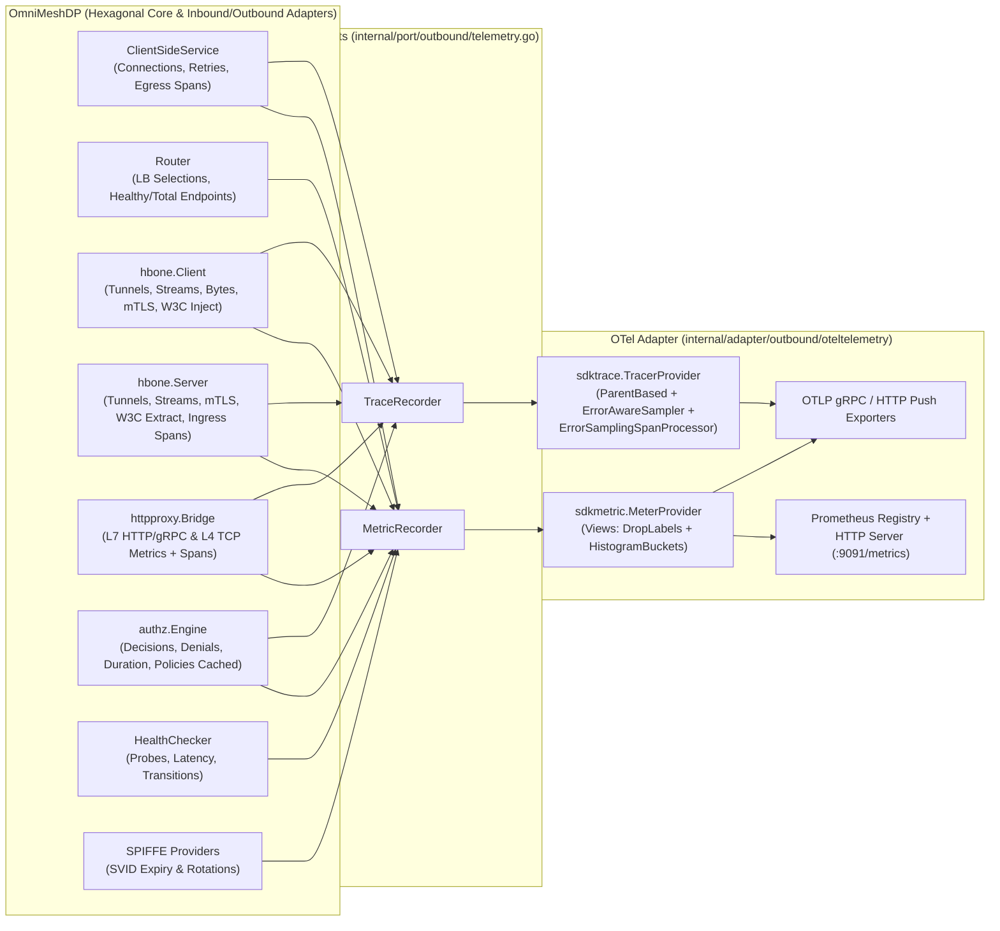
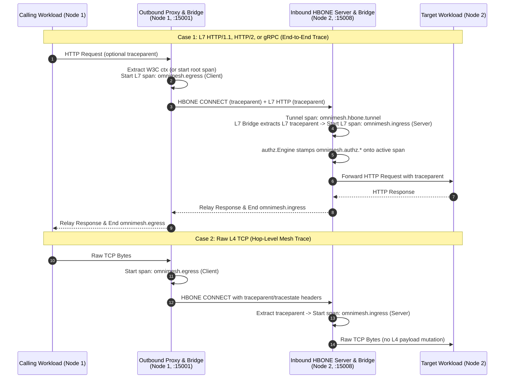

# Data Plane Observability Specification (OpenTelemetry Metrics & Traces)

## 1. Introduction & Scope

This document specifies how **OmniMeshDP** captures, configures, and exports **OpenTelemetry Metrics and Distributed Traces** across the mesh data plane (`internal/application/proxy`, `internal/adapter/inbound/hbone`, `internal/application/httpproxy`, `internal/application/authz`, `internal/application/service`, `internal/adapter/outbound/spiffe`, and `internal/application/orchestrator`).

This specification aligns OmniMeshDP directly with the control plane RFCs in `omnimeshcontrol/rfcs`:
- **RFC-0005** (`rfc-0005-observability.md`): Metrics catalog (`omnimesh.agent.*`), distributed tracing span structure and attributes, Prometheus `/metrics` scraping, OTLP push exporters, sampling, and cardinality management.
- **RFC-0001** (`rfc-0001-initial-design.md`): HBONE HTTP/2 tunnel header propagation (`traceparent`, `tracestate`, SPIFFE identity, service metadata) for both L7 and L4 TCP hop-level tracing.
- **RFC-0003** (`rfc-0003-traffic-policies.md`): Retry and load-balancing instrumentation (`spec/routing.md`).
- **RFC-0004** (`rfc-0004-authorization.md`): Authorization decision, denial, evaluation latency, and cached policy metrics (`spec/authorization.md`).

> [!NOTE]
> **Logs Out of Scope**: Structured OpenTelemetry log emission and trace-log correlation (`rfc-0005-observability.md` §7) are intentionally deferred and will be defined in a separate specification. Existing `log.Printf` operational and audit logs remain unchanged in this phase.

---

## 2. Design Principles

1. **OpenTelemetry Native**: All metrics and trace instrumentation uses the standard OpenTelemetry Go SDK (`go.opentelemetry.io/otel v1.47.0`, `sdk`, `sdk/metric`), supporting vendor-neutral Prometheus pull scraping and OTLP gRPC/HTTP push export.
2. **Hexagonal Architecture Separation**:
   - `internal/domain` and `internal/application` **MUST NOT** import any OpenTelemetry SDK or exporter packages.
   - All telemetry emission flows through pure domain types (`internal/domain/model/observability.go`) and outbound ports (`internal/port/outbound/telemetry.go`).
   - All OTel SDK wiring, Views, Samplers, SpanProcessors, Prometheus HTTP server, and OTLP exporters live strictly in `internal/adapter/outbound/oteltelemetry`.
3. **Zero / Minimal Overhead When Disabled or Uninstrumented**:
   - All data-plane components default to a zero-cost `NoopTelemetryProvider` when telemetry is not configured or disabled.
   - Metric attribute slices use fixed-size stack buffers on hot paths where possible, and `authz.Engine` skips `time.Now()` timing overhead when no observer is registered.
4. **Opt-In Pipeline Activation**:
   - `observability.metrics.enabled` and `observability.traces.enabled` default to `false` so local development instances, CLI tools, and parallel unit tests do not unexpectedly bind `:9091` or attempt outbound OTLP dials unless explicitly enabled via JSON config or `OBSERVABILITY_*` environment variables.
5. **Cardinality Discipline**:
   - Workloads are identified by normalized `(namespace, service_name)` parsed from verified SPIFFE URIs (`spiffe://<trust-domain>/ns/<ns>/sa/<sa>`), never raw PIDs, ephemeral client ports, or unbounded raw certificate strings.
   - Combined `source_service × destination_service` request metrics can be disabled while keeping separated ingress/egress counters active, and operators can drop labels or tune histogram buckets via OTel Metric Views.

---

## 3. End-to-End Architecture



---

## 4. Configuration Surface (`AppConfig.Observability`)

### 4.1 JSON Schema & Defaults

`AppConfig` includes an `observability` block (`model.ObservabilityConfig`) matching RFC-0005 §3 and §10:

```json
{
  "observability": {
    "metrics": {
      "enabled": false,
      "endpoint": ":9091",
      "path": "/metrics",
      "export_interval": "15s",
      "combined_request_metric": {
        "enabled": true
      },
      "exporters": [
        {
          "type": "prometheus"
        }
      ],
      "cardinality": {
        "max_label_cardinality": 1000,
        "drop_labels": {},
        "histogram_buckets": {
          "duration_ms": [1, 5, 10, 25, 50, 100, 250, 500, 1000, 2500, 5000, 10000],
          "authz_duration_us": [1, 5, 10, 25, 50, 100, 250, 500, 1000, 5000]
        }
      }
    },
    "traces": {
      "enabled": false,
      "sampler": "parentbased_traceidratio",
      "sample_rate": 0.01,
      "always_sample_errors": true,
      "max_error_traces_per_sec": 100,
      "exporters": []
    },
    "resource": {
      "service_name": "omnimesh-agent",
      "service_namespace": "omnimesh",
      "deployment_environment": "",
      "attributes": {}
    }
  }
}
```

#### Exporter Entries (`TelemetryExporterConfig`)
Each exporter object in `metrics.exporters` or `traces.exporters` supports:
- `type`:
  - Metrics: `"prometheus"`, `"otlp-grpc"`, `"otlp-http"`
  - Traces: `"otlp-grpc"`, `"otlp-http"`, `"none"`
- `target`: Collector host:port or URL (required for `otlp-grpc` and `otlp-http`, e.g. `"otel-collector:4317"` or `"http://otel-collector:4318"`).
- `insecure`: Boolean (uses insecure transport instead of TLS when `true`).
- `headers`: Optional `map[string]string` of metadata/HTTP headers (e.g., auth tokens).
- `timeout`: Optional export timeout duration string (must be `> 0` if set).

### 4.2 Environment Variable Overrides

Environment variables override JSON file values in `model.LoadConfig`:

| Env Variable | Fallback Standard OTel Env | Target Field |
|---|---|---|
| `OBSERVABILITY_METRICS_ENABLED` | — | `observability.metrics.enabled` |
| `OBSERVABILITY_METRICS_ENDPOINT` | — | `observability.metrics.endpoint` |
| `OBSERVABILITY_METRICS_PATH` | — | `observability.metrics.path` |
| `OBSERVABILITY_METRICS_EXPORT_INTERVAL` | — | `observability.metrics.export_interval` |
| `OBSERVABILITY_METRICS_COMBINED_REQUEST_ENABLED` | — | `observability.metrics.combined_request_metric.enabled` |
| `OBSERVABILITY_METRICS_OTLP_ENDPOINT` | — | Upserts/adds an OTLP metrics exporter target |
| `OBSERVABILITY_METRICS_OTLP_PROTOCOL` | — | `"grpc"` (`otlp-grpc`, default) or `"http"` (`otlp-http`) |
| `OBSERVABILITY_METRICS_OTLP_INSECURE` | — | Sets `insecure` on OTLP metrics exporter |
| `OBSERVABILITY_TRACES_ENABLED` | — | `observability.traces.enabled` |
| `OBSERVABILITY_TRACES_SAMPLER` | `OTEL_TRACES_SAMPLER` | `observability.traces.sampler` |
| `OBSERVABILITY_TRACES_SAMPLE_RATE` | `OTEL_TRACES_SAMPLER_ARG` | `observability.traces.sample_rate` |
| `OBSERVABILITY_TRACES_ALWAYS_SAMPLE_ERRORS` | — | `observability.traces.always_sample_errors` |
| `OBSERVABILITY_TRACES_MAX_ERROR_TRACES_PER_SEC` | — | `observability.traces.max_error_traces_per_sec` |
| `OBSERVABILITY_TRACES_OTLP_ENDPOINT` | `OTEL_EXPORTER_OTLP_TRACES_ENDPOINT`, `OTEL_EXPORTER_OTLP_ENDPOINT` | Upserts/adds an OTLP traces exporter target |
| `OBSERVABILITY_TRACES_OTLP_PROTOCOL` | `OTEL_EXPORTER_OTLP_TRACES_PROTOCOL`, `OTEL_EXPORTER_OTLP_PROTOCOL` | `"grpc"` / `"http"` / `"http/protobuf"` |
| `OBSERVABILITY_TRACES_OTLP_INSECURE` | — | Sets `insecure` on OTLP traces exporter |
| `OBSERVABILITY_SERVICE_NAME` | `OTEL_SERVICE_NAME` | `observability.resource.service_name` |
| `OBSERVABILITY_SERVICE_NAMESPACE` | — | `observability.resource.service_namespace` |
| `OBSERVABILITY_DEPLOYMENT_ENVIRONMENT` | — | `observability.resource.deployment_environment` |

### 4.3 Validation Rules (`ObservabilityConfig.Validate`)

Invalid configurations fail fast at Step 1 (`domain.ErrInvalidObservabilityConfig`):
- `metrics.endpoint`: When non-empty (or when `metrics.enabled == true` with a `prometheus` exporter), must be a valid `host:port` accepted by `net.SplitHostPort`.
- `metrics.path`: When non-empty, must begin with `"/"`.
- `metrics.export_interval`: Must parse as a duration `> 0`.
- `metrics.cardinality.max_label_cardinality`: Must be `>= 0`.
- `metrics.cardinality.histogram_buckets`: Every bucket slice must be non-empty, contain only finite numbers (no `NaN` or `Inf`), and be strictly increasing (`b[i] > b[i-1]`).
- `metrics.exporters`: `type` must be `"prometheus"`, `"otlp-grpc"`, or `"otlp-http"`; OTLP exporters require a non-empty `target` and valid positive `timeout` (if specified).
- `traces.sampler`: Must be one of `""`, `"parentbased_traceidratio"`, `"always_on"`, `"always_off"`, `"traceidratio"`.
- `traces.sample_rate`: Must satisfy `0.0 <= sample_rate <= 1.0` (and not `NaN`).
- `traces.max_error_traces_per_sec`: Must be `>= 0`.
- `traces.exporters`: `type` must be `"otlp-grpc"`, `"otlp-http"`, or `"none"`; OTLP exporters require a non-empty `target` and valid positive `timeout` (if specified).

---

## 5. Agent Metrics Catalog (RFC-0005 §5)

All metrics use the `omnimesh.agent.` prefix and attach the shared OpenTelemetry Resource (`service.name`, `service.namespace`, `omnimesh.node`, and optional `deployment.environment.name` + custom resource attributes).

### 5.1 Request Traffic (Core)

Emitted per HTTP/1.1 request, per HTTP/2 / gRPC stream (in `httpproxy.Bridge`), and per L4 TCP proxied session (in `httpproxy.Bridge.bridgeL4` or `hbone` fallback when L7 is disabled):

| Metric | OTel Instrument | Description | Attributes |
|---|---|---|---|
| `omnimesh.agent.requests.total` | `Int64Counter` | Total requests proxied *(gated by `combined_request_metric.enabled`)* | `source_service`, `source_namespace`, `destination_service`, `destination_namespace`, `protocol`, `response_code` |
| `omnimesh.agent.requests.ingress.total` | `Int64Counter` | Requests received by local services *(always emitted on inbound)* | `source_service`, `source_namespace`, `protocol`, `response_code` |
| `omnimesh.agent.requests.egress.total` | `Int64Counter` | Requests sent to upstream services *(always emitted on outbound)* | `destination_service`, `destination_namespace`, `protocol`, `response_code` |
| `omnimesh.agent.requests.duration_ms` | `Float64Histogram` | End-to-end request latency from the agent perspective (ms) | `source_service`, `destination_service`, `protocol` |
| `omnimesh.agent.requests.active` | `Int64UpDownCounter` | Currently in-flight requests | `destination_service`, `destination_namespace` |
| `omnimesh.agent.requests.bytes_sent` | `Int64Counter` | Bytes sent in the request direction | `source_service`, `destination_service` |
| `omnimesh.agent.requests.bytes_received` | `Int64Counter` | Bytes received in the response direction | `source_service`, `destination_service` |

- `protocol` values: `"http1"`, `"http2"`, `"grpc"`, `"tcp"`.
- `response_code` values: HTTP status code string (e.g. `"200"`, `"403"`, `"502"`), gRPC status code string when gRPC (`"0"`, `"7"`, etc.), or `"ok"` / `"error"` for L4 TCP streams.

### 5.2 Connection & HBONE Tunnel Metrics

Emitted by `proxy.ClientSideService`, `hbone.Client`, and `hbone.Server`:

| Metric | OTel Instrument | Description | Attributes |
|---|---|---|---|
| `omnimesh.agent.connections.active` | `Int64UpDownCounter` | Active proxied connections | `destination_service`, `destination_namespace` |
| `omnimesh.agent.connections.total` | `Int64Counter` | Total connections handled | `destination_service`, `result` (`success`, `refused`, `timeout`, `forbidden`, `bad_gateway`, `no_route`, `error`) |
| `omnimesh.agent.connections.duration_ms` | `Float64Histogram` | Connection lifetime (ms) | `destination_service` |
| `omnimesh.agent.hbone.tunnels.active` | `Int64UpDownCounter` | Active underlying HBONE HTTP/2 transport connections | `peer_node`, `direction` (`egress`/`ingress`) |
| `omnimesh.agent.hbone.streams.active` | `Int64UpDownCounter` | Active HBONE `CONNECT` HTTP/2 streams | `peer_node`, `direction` |
| `omnimesh.agent.hbone.streams.total` | `Int64Counter` | Total HBONE `CONNECT` streams opened | `peer_node`, `destination_service`, `result` |
| `omnimesh.agent.hbone.bytes_sent` | `Int64Counter` | Bytes written to HBONE tunnels | `peer_node`, `direction` |
| `omnimesh.agent.hbone.bytes_received` | `Int64Counter` | Bytes read from HBONE tunnels | `peer_node`, `direction` |

### 5.3 mTLS & SPIRE Workload SVID Metrics

Emitted by `hbone.Client` (egress `DialTLSContext`), `hbone.Server` (TLS handshake callbacks), `SVIDMonitor` (`SpiffeTLSProvider`), and `DelegatedWorkloadProvider`:

| Metric | OTel Instrument | Description | Attributes |
|---|---|---|---|
| `omnimesh.agent.mtls.handshakes.total` | `Int64Counter` | mTLS handshakes completed or failed | `peer_service`, `result` (`success`/`failure`) |
| `omnimesh.agent.mtls.handshakes.duration_ms` | `Float64Histogram` | mTLS handshake latency (ms) | `direction` (`egress`/`ingress`) |
| `omnimesh.agent.mtls.svid.expiry_seconds` | `Float64Gauge` | Remaining lifetime of active SVIDs (seconds) | `spiffe_id` |
| `omnimesh.agent.mtls.svid.rotations.total` | `Int64Counter` | Observed SVID certificate rotations | `spiffe_id` |

### 5.4 Retries

Emitted by `proxy.ClientSideService.tunnelWithRetries` (`spec/routing.md` §5):

| Metric | OTel Instrument | Description | Attributes |
|---|---|---|---|
| `omnimesh.agent.retries.total` | `Int64Counter` | Retry attempts triggered after initial tunnel failure | `destination_service`, `retry_reason` (`502_bad_gateway`, `5xx`, `timeout`, `connection_failure`) |
| `omnimesh.agent.retries.exhausted` | `Int64Counter` | Connections where all retry attempts failed | `destination_service` |
| `omnimesh.agent.retries.success` | `Int64Counter` | Connections that succeeded on a retry (`attempt > 0`) | `destination_service` |

### 5.5 Load Balancing

Emitted by `proxy.Router` on control-path snapshot compilation and data-path selection:

| Metric | OTel Instrument | Description | Attributes |
|---|---|---|---|
| `omnimesh.agent.lb.selections.total` | `Int64Counter` | Endpoint selections by algorithm | `destination_service`, `endpoint`, `algorithm` |
| `omnimesh.agent.lb.endpoints.healthy` | `Int64Gauge` | Healthy/eligible endpoints in compiled snapshot | `destination_service` |
| `omnimesh.agent.lb.endpoints.total` | `Int64Gauge` | Total configured endpoints in compiled snapshot | `destination_service` |
| `omnimesh.agent.lb.no_healthy_endpoints` | `Int64Counter` | Route lookups finding zero healthy endpoints | `destination_service` |

### 5.6 Health Checks

Emitted by `service.HealthChecker`:

| Metric | OTel Instrument | Description | Attributes |
|---|---|---|---|
| `omnimesh.agent.health.probes.total` | `Int64Counter` | Active health probes executed | `service`, `endpoint`, `protocol`, `result` (`success`/`failure`) |
| `omnimesh.agent.health.probes.duration_ms` | `Float64Histogram` | Health probe round-trip latency (ms) | `service`, `protocol` |
| `omnimesh.agent.health.transitions` | `Int64Counter` | Endpoint health status transitions | `service`, `endpoint`, `from_state`, `to_state` |

### 5.7 Authorization

Emitted by `AuthzTelemetryObserver` (`inbound.AuthzDecisionObserver`) and `authz.Engine` policy count updates:

| Metric | OTel Instrument | Description | Attributes |
|---|---|---|---|
| `omnimesh.agent.authz.decisions.total` | `Int64Counter` | Authorization evaluations | `source_service`, `destination_service`, `decision` (`allow`, `deny`, `dry_run`) |
| `omnimesh.agent.authz.denials.total` | `Int64Counter` | Authorization denials by reason | `source_service`, `destination_service`, `reason` |
| `omnimesh.agent.authz.evaluation.duration_us` | `Float64Histogram` | Policy evaluation latency (microseconds) | `layer` (`l4`/`l7`) |
| `omnimesh.agent.authz.policies.cached` | `Int64Gauge` | Number of compiled policies in the active snapshot | — |

### 5.8 Reserved / Future Metrics (RFC-0005 §5.5 & §5.6)

The following metric families from RFC-0005 are reserved for when Circuit Breaker and Rate Limiting enforcement are implemented in OmniMeshDP:
- **Circuit Breaker**: `omnimesh.agent.circuit_breaker.{state,transitions,rejected,half_open.success,half_open.failure}`
- **Rate Limiter**: `omnimesh.agent.rate_limiter.{requests.allowed,requests.rejected,requests.queued,tokens.available,concurrent.active}`

### 5.9 Cardinality Management & Prometheus Exposition

1. **Identity Normalization**: `model.ParseCallerService(callerIdentity)` parses SPIFFE workload URIs (`spiffe://<td>/ns/<ns>/sa/<sa>`) into low-cardinality `(service_name, namespace)` labels. Non-workload or unauthenticated callers map to `"unknown"`.
2. **Combined Metric Toggle**: Setting `observability.metrics.combined_request_metric.enabled: false` suppresses `omnimesh.agent.requests.total` while keeping `omnimesh.agent.requests.ingress.total` and `omnimesh.agent.requests.egress.total` active.
3. **Label Dropping (OTel Metric Views)**: `observability.metrics.cardinality.drop_labels` registers `sdkmetric.NewView` filters excluding specified attribute keys per instrument name (e.g., dropping `source_service` from `omnimesh.agent.requests.total`).
4. **Histogram Bucket Tuning**: `observability.metrics.cardinality.histogram_buckets` configures `sdkmetric.AggregationExplicitBucketHistogram`:
   - `duration_ms` applies to `*.duration_ms` histograms (default `[1, 5, 10, 25, 50, 100, 250, 500, 1000, 2500, 5000, 10000]`).
   - `authz_duration_us` applies to `omnimesh.agent.authz.evaluation.duration_us` (default `[1, 5, 10, 25, 50, 100, 250, 500, 1000, 5000]`).
   - Exact metric names can also override individual histograms.
5. **Cardinality Warning Threshold**: `max_label_cardinality` tracks unique attribute combinations per metric and logs a one-time warning when exceeded.
6. **Prometheus Endpoint**: Served at `observability.metrics.endpoint` + `observability.metrics.path` (default `:9091/metrics`) using `promhttp.HandlerFor` with `EnableOpenMetrics: true`. The OTel Prometheus exporter is configured with `WithoutUnits()` so metric names retain clean RFC-0005 names (e.g., `omnimesh_agent_requests_duration_ms_bucket`) instead of doubled unit suffixes (`_duration_ms_milliseconds`).

---

## 6. Distributed Tracing (RFC-0005 §6)

### 6.1 End-to-End vs. Hop-Level Propagation



### 6.2 Span Names & Kinds

| Span Name | Kind | Created By | Lifecycle |
|---|---|---|---|
| `omnimesh.egress` | `Client` | `ClientSideService` (TCP/attempt) or `httpproxy.Bridge` (L7 Outbound) | Wraps each outbound request or TCP tunnel attempt. When an HBONE tunnel upgrades to L7 HTTP/1.1 or HTTP/2, the outer tunnel span is renamed to `omnimesh.hbone.tunnel` so per-request L7 spans carry `omnimesh.egress`. |
| `omnimesh.ingress` | `Server` | `hbone.Server` (TCP/tunnel) or `httpproxy.Bridge` (L7 Inbound) | Wraps each inbound request or TCP tunnel. Renamed to `omnimesh.hbone.tunnel` when an inbound HBONE stream upgrades to L7 HTTP/1.1 or HTTP/2. |
| `omnimesh.hbone.tunnel` | `Client` / `Server` | `httpproxy.Bridge` (rename on L7 upgrade) | Represents the underlying persistent HBONE tunnel session hosting L7 HTTP/1.1 keep-alive or multiplexed HTTP/2 streams. |

### 6.3 Span Attributes (RFC-0005 §6.3)

| Attribute Key | Description |
|---|---|
| `omnimesh.source.service` | Calling workload service name |
| `omnimesh.source.namespace` | Calling workload namespace |
| `omnimesh.destination.service` | Target service name |
| `omnimesh.destination.namespace` | Target service namespace |
| `omnimesh.destination.endpoint` | Target endpoint address (`host:port`) |
| `omnimesh.protocol` | Effective protocol (`http`, `grpc`, `tcp`) |
| `omnimesh.direction` | Agent role (`egress` or `ingress`) |
| `omnimesh.authz.decision` | Authorization outcome (`allow`, `deny`, `dry_run`) |
| `omnimesh.authz.policy` | Matched authorization policy name |
| `omnimesh.retry.attempt` | Outbound routing retry attempt index (`0`, `1`, `2`, ...) |
| `omnimesh.node` | Local agent `node_id` |
| `http.method` | HTTP request method (`GET`, `POST`, ...) |
| `http.url` | Request path / target |
| `http.status_code` | HTTP response status code |
| `rpc.system` | `"grpc"` when Content-Type is `application/grpc` |
| `rpc.service` | Parsed gRPC service name |
| `rpc.method` | Parsed gRPC method name |
| `rpc.grpc.status_code` | gRPC response status code from `Grpc-Status` |

### 6.4 Coordination with `TraceContextInterceptor` (`spec/http-headers.md`)

When OTel tracing is enabled (`observability.traces.enabled == true`), `httpproxy.Bridge` runs `TraceRecorder` **before** `TraceContextInterceptor`:
1. `TraceRecorder` extracts any incoming `traceparent`/`tracestate` from the HTTP request, starts the active OTel span (applying `observability.traces.sampler` and `sample_rate`), injects the resulting `traceparent`/`tracestate` back into the outgoing HTTP headers, and populates `HTTPRequestContext.TraceContext`.
2. `TraceContextInterceptor` detects that `req.TraceContext.Valid` is already `true` and skips synthetic `traceparent` generation, while still handling `x-request-id` generation and optional response echoing.
3. This ensures `ParentBased(TraceIDRatioBased)` sampling is **not** bypassed by `http.tracing.default_sampled: true`. When OTel tracing is disabled, `TraceContextInterceptor` retains its exact standalone behavior from `spec/http-headers.md`.

### 6.5 Error-Biased Sampling (`always_sample_errors`)

When `observability.traces.always_sample_errors == true`:
1. **`errorAwareSampler`** wraps the configured base sampler (`parentbased_traceidratio`, `traceidratio`, `always_off`). Whenever the base sampler returns `Drop`, `errorAwareSampler` upgrades the decision to `sdktrace.RecordOnly` so span attributes and errors are recorded in memory during execution without marking the `traceparent` sampled bit (`00`).
2. **`errorSamplingSpanProcessor`** wraps the underlying `BatchSpanProcessor` (or `SimpleSpanProcessor`):
   - If `SpanContext().IsSampled()` is `true`, the span is forwarded normally.
   - If `SpanContext().IsSampled()` is `false`, `always_sample_errors` is `true`, `s.Status().Code == codes.Error` (e.g., HTTP 5xx, gRPC non-OK, `403 Forbidden`, `502 Bad Gateway`, connection/tunnel failure), and the per-second token bucket (`max_error_traces_per_sec`) permits, the span is promoted with `FlagsSampled` and exported.
   - Otherwise, the unsampled non-error span is discarded with zero export cost.

---

## 7. Startup, Shutdown & Component Mapping

### 7.1 `spec/run-start.md` Lifecycle Integration

- **Step 1**: Load & validate `AppConfig.Observability`. Initialize `oteltelemetry.NewProvider` immediately after config load (if `metrics.enabled || traces.enabled`); fail fast with `domain.ErrObservabilityInitFailed` if binding `:9091` or initializing exporters fails.
- **Step 2**: Attach `SVIDMonitor` to `SpiffeTLSProvider.Source()` and wire `MetricRecorder` into `DelegatedWorkloadProvider`.
- **Step 3**: Inject `TelemetryProvider` / `MetricRecorder` into `Router`, `ClientSideService`, `ServerSideService`, `httpproxy.Bridge`, and `authz.Engine` (`AuthzTelemetryObserver` + `WithPolicyCountObserver`).
- **Step 9**: Pass `MetricRecorder` into `service.ManagerConfig` -> `HealthChecker`.
- **Step 10 (`Cleanup`)**: Stop `SVIDMonitor`, drain proxy/server goroutines, then call `TelemetryProvider.Shutdown(ctx)` (with a 5-second timeout) to flush buffered OTel metrics and trace batches before process exit.

### 7.2 Component Mapping

| File / Package | Responsibility |
|---|---|
| `spec/observability.md` | This specification |
| `internal/domain/errors.go` | `ErrInvalidObservabilityConfig`, `ErrObservabilityInitFailed` |
| `internal/domain/model/observability.go` | `ObservabilityConfig`, `MetricsConfig`, `TracesConfig`, `TelemetryResourceConfig`, validation, `ParseCallerService` |
| `internal/domain/model/app_config.go` | `AppConfig.Observability`, `OBSERVABILITY_*` / `OTEL_*` env overrides |
| `internal/domain/model/authz.go` | `AuthzDecision.EvaluationDuration` |
| `internal/port/outbound/telemetry.go` | `TelemetryProvider`, `MetricRecorder`, `TraceRecorder`, `SpanHandle`, `NoopTelemetryProvider`, canonical metric/span constants |
| `internal/adapter/outbound/oteltelemetry/` | `Provider`, `otelMetricRecorder` (Views + Prometheus + OTLP), `otelTraceRecorder` (`errorAwareSampler` + `errorSamplingSpanProcessor` + OTLP), `AuthzTelemetryObserver`, `SVIDMonitor` |
| `internal/adapter/outbound/spiffe/delegated_provider.go` | Delegated SVID expiry & rotation metrics |
| `internal/application/service/health.go` & `manager.go` | Active health probe & state transition metrics |
| `internal/application/authz/engine.go` | Evaluation timing & `WithPolicyCountObserver` |
| `internal/application/proxy/router.go` | LB selection, endpoint health gauges, no-healthy-endpoints metrics |
| `internal/adapter/inbound/hbone/{client,server}.go` | HBONE tunnel/stream/bytes metrics, mTLS handshake metrics, W3C `CONNECT` propagation, `omnimesh.ingress` spans |
| `internal/application/proxy/{client,server}.go` | Connection metrics, retry metrics, `omnimesh.egress` spans |
| `internal/application/httpproxy/{bridge,interceptor_trace,interceptor_authz}.go` | L7 HTTP/gRPC & L4 TCP request metrics, L7 `omnimesh.egress`/`omnimesh.ingress` spans, `TraceContextInterceptor` coordination |
| `internal/application/orchestrator/orchestrator.go` | Lifecycle initialization, wiring, and graceful telemetry shutdown |
