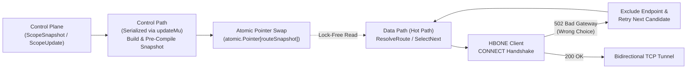

# Routing Mechanisms Specification

## 1. Introduction

This document specifies how traffic routing must be implemented in **OmniMeshDP** (`internal/application/proxy` and `internal/adapter/inbound/hbone`).

When local outbound TCP traffic is intercepted and redirected to `ClientSideService`, the data plane must resolve the destination virtual IP (`MeshAddr`) into a concrete mesh endpoint (`TargetHost` + `ServiceID` / `RouteName`) and establish an HTTP/2 HBONE `CONNECT` tunnel to the remote agent hosting that service.

### Core Requirements

1. **Fast, yet correct decisions**: Route resolution runs on the hot path of every new connection and must be lock-free (or minimal-contention), low-allocation, and O(1)/O(log k) while accurately honoring Control Plane state and traffic policies.
2. **Control Plane–driven traffic rules with safe defaults**: Routing configuration (services, routes, traffic policies, and endpoint health) is supplied by `omnimeshcontrol` via `ScopeSnapshot` and `ScopeUpdate`. When no traffic rule applies to a service, a well-defined default behavior must be used.
3. **Random default selection**: In the absence of an explicit load-balancing rule, the router must select an eligible endpoint **uniformly at random** (replacing the previous round-robin default).
4. **Peer `502 Bad Gateway` handling as a wrong routing choice**: When the remote agent responds with HTTP `502 Bad Gateway` during HBONE tunnel establishment (meaning it could not connect to the target service locally), the calling agent must treat that response as a **wrong/stale routing choice** — **not** as an unhealthy endpoint. The router must select a different candidate node/service and retry up to a bounded number of attempts before returning an error to the caller.

---

## 2. Control Plane Inputs

The routing subsystem consumes state delivered by the Control Plane (`omnimesh.v1`) via `ScopeSnapshot` (full replacement) and `ScopeUpdate` (`ADD`, `MODIFY`, `REMOVE`):

| Protobuf Message | Key Fields Used by Routing | Role |
|---|---|---|
| `ServiceInfo` | `namespace`, `name`, `mesh_addr`, `port`, `protocol` | Maps intercepted destination IP (`mesh_addr`) to logical service `(namespace, name)`. |
| `RouteInfo` | `namespace`, `service_name`, `target_nodes[]` | Maps logical service to candidate `NodeEndpointInfo` entries. |
| `NodeEndpointInfo` | `node_id`, `addr`, `route_name`, `target`, `target_address`, `labels` | Candidate node and service instance hosting the service. |
| `TrafficPolicyInfo` | `target_service_namespace`, `target_service_name`, `routes[]`, `load_balancer`, `retry` | Traffic split rules, load-balancing algorithm, and retry configuration for a target service. |
| `EndpointHealthInfo` | `namespace`, `service_name`, `node_id`, `route_name`, `status` | Control Plane–authoritative endpoint health (`HEALTHY`, `UNHEALTHY`, `DRAINING`, `UNSPECIFIED`). |

Local node identity (`nodeID`, `target`, `targetAddress`) is configured on the `Router` and used to resolve cross-network `TargetAddress` routing.

---

## 3. Architecture: Control Path vs. Data Path

To guarantee that routing decisions are **fast** without sacrificing **correctness**, the router strictly separates **control-path compilation** from **data-path lookup**.



### 3.1 Control Path (Slow Path)

- All `ApplySnapshot`, `ApplyUpdate`, and local node metadata updates are serialized using `updateMu`.
- Updates are applied to a mutable working copy of the raw state (`services`, `routes`, `trafficPolicies`, `endpointHealth`, `nodes`, `targetAddresses`, `namespaces`).
- Before publishing, the router **pre-compiles** an immutable `compiledServicePlan` for every known service IP (`MeshAddr`):
  1. **Endpoint Identity & Deduplication**: Each candidate endpoint has a canonical `EndpointKey` uniquely identifying `(NodeID, RouteName, Addr)`.
  2. **Health Filtering**: Endpoints whose Control Plane `EndpointHealthInfo.Status` is `UNHEALTHY` or `DRAINING` are excluded from the compiled active pool. Endpoints with `HEALTHY` or `UNSPECIFIED` status remain eligible.
  3. **Target Host Pre-Resolution**: For each endpoint, the effective HBONE `TargetHost` is resolved once at compile time:
     - If `endpoint.TargetAddress != ""` and `endpoint.TargetAddress != localTargetAddress`, `TargetHost = endpoint.TargetAddress`.
     - Otherwise, `TargetHost = endpoint.Addr`.
  4. **Rule Compilation (`TrafficPolicyInfo`)**:
     - Match endpoints against each `TrafficRouteInfo` destination selector (`Target` and `Labels`) once at compile time.
     - Pre-compute cumulative weight prefix sums (`cumulativeWeights`) over active route groups (groups with `Weight > 0` and at least one eligible endpoint).
     - Resolve the effective `LoadBalancerAlgorithm` and `RetryConfig` (applying defaults where omitted).
- Once compilation completes, the immutable snapshot is published via a single `atomic.Pointer[routeSnapshot].Store(newSnapshot)`.

### 3.2 Data Path (Hot Path)

- Route resolution loads the active snapshot with a single `atomic.Pointer.Load()` — **zero mutex acquisitions** on the hot path.
- Destination lookup is an O(1) map lookup (keyed by destination IP; optionally `uint32` / `netip.Addr` to avoid per-connection string formatting allocations).
- Random selection uses Go's `math/rand/v2` (per-P lock-free PRNG) to avoid global mutex contention or atomic cache-line bouncing across CPU cores.
- Per-connection exclusion state for retries uses a small stack-allocated buffer/bitset (no heap allocations in the common 0-retry or few-retry case).

---

## 4. Routing Decision Algorithm

Given an intercepted connection targeting `(destIP, destPort)` and an optional set of excluded endpoints (empty on the initial attempt):

### 4.1 Service Lookup

1. Look up `compiledServicePlan` for `destIP`.
2. If no service matches `destIP`:
   - If a legacy/explicit fallback `defaultTargetHost` is configured and non-empty, preserve fallback behavior (`TargetHost = defaultTargetHost`, `RealDest = destIP:destPort`, no retries).
   - Otherwise, return `ErrNoRoute`.
3. If the service exists but has zero eligible (non-`UNHEALTHY`, non-`DRAINING`) endpoints, return `ErrNoHealthyEndpoints`.

### 4.2 Rule Evaluation vs. Default Behavior

#### Case A: No Traffic Rules (`TrafficPolicyInfo == nil` or `len(policy.Routes) == 0`)

- All eligible endpoints for the service form a single default pool.
- Exclude any endpoints already tried in this connection's retry session. If none remain, stop and return `ErrNoAvailableEndpoints`.
- Select one endpoint using the resolved load-balancer algorithm:
  - **Default (when `LoadBalancer == nil` or `Algorithm == LOAD_BALANCER_ALGORITHM_UNSPECIFIED`)**: **Uniform Random (`RANDOM`)**.
  - Explicitly **not** Round Robin.

#### Case B: Traffic Rules Present (`len(policy.Routes) > 0`)

When a `TrafficPolicyInfo` defines one or more `TrafficRouteInfo` rules:

1. **Destination Matching** (performed during pre-compilation):
   An endpoint matches a `TrafficRouteDestinationInfo` if and only if:
   - `destination.Target == ""` **OR** `endpoint.Target == destination.Target`, **AND**
   - For every key-value pair `(k, v)` in `destination.Labels`, `endpoint.Labels[k] == v`.

2. **Active Weighted Groups**:
   - Only route rules with `Weight > 0` and at least one eligible, **non-excluded** endpoint participate in selection.
   - If a service has traffic rules defined, but **zero** eligible endpoints match *any* rule, return `ErrNoMatchingEndpoints` (do not silently bypass explicit traffic routing rules to unpermitted subsets).
   - Among active groups with remaining untried endpoints, compute the sum of weights $W = \sum_i w_i$.
   - Draw $r \in [0, W)$ uniformly via `rand/v2.IntN(W)` and select the first group whose cumulative weight exceeds $r$.

3. **Endpoint Selection within the Chosen Group**:
   - Apply the service's effective `LoadBalancerAlgorithm` across the non-excluded endpoints in the selected group.
   - Note: If the same endpoint matches multiple route groups, exclusion tracking operates on the canonical `EndpointKey`, ensuring an endpoint that returned `502` is never chosen again via another group during the same connection.

### 4.3 Supported Load-Balancing Algorithms

| `LoadBalancerAlgorithm` | Behavior |
|---|---|
| `UNSPECIFIED` *(default)* | Alias for `RANDOM`. |
| `RANDOM` | Picks one non-excluded endpoint uniformly at random (`rand/v2.IntN(n)`). Zero shared mutable state; fast and contention-free. |
| `WEIGHTED_ROUND_ROBIN` | Advances a per-pool atomic counter (`atomic.Uint64`) modulo the candidate count, skipping excluded endpoints. (Group-level weights are already enforced by `TrafficPolicyInfo.Routes`.) |
| `LEAST_CONNECTIONS` | Tracks active in-flight HBONE tunnels per `EndpointKey` via `atomic.Int64`. Picks the non-excluded endpoint with the lowest active connection count (full scan for small pools `<= 8`, or Power of Two Choices (P2C) for larger pools), breaking ties uniformly at random. |

### 4.4 Multiple Policies Precedence

If the Control Plane delivers multiple `TrafficPolicyInfo` resources targeting the same `(target_service_namespace, target_service_name)`:
- Selection must be deterministic across all agents: sort matching policies lexicographically by `(Namespace, Name)` and select the first policy (logging a warning on conflict), unless future merging semantics are explicitly specified.

---

## 5. Handling Peer `502 Bad Gateway` & Retries

### 5.1 Why `502` Is Safe to Retry at L4

In OmniMesh's HBONE server (`internal/adapter/inbound/hbone/server.go`), when a remote agent receives an HTTP/2 `CONNECT` request:
1. It resolves `x-omnimesh-node-service-id` (or `x-omnimesh-real-dest`) and dials the local service over TCP.
2. If that local dial fails, the remote agent immediately responds with **`502 Bad Gateway`** and terminates the stream — **never sending `200 OK`**.
3. On the client side (`internal/adapter/inbound/hbone/client.go`), bidirectional streaming (`io.Copy` from `localConn`) **only begins after `200 OK` is received**.

Consequently, when a `502` is received:
- **Zero application bytes** have been read from or written to `localConn`.
- The caller's TCP connection is completely intact and unaware of the failed routing attempt.
- Retrying against a different mesh endpoint is completely transparent to the caller.

### 5.2 Semantics of `502 Bad Gateway`

A `502 Bad Gateway` returned by a peer agent during the HBONE `CONNECT` handshake MUST be treated according to these exact rules:

1. **Wrong Routing Choice**: Interpret `502` as evidence that the chosen `(NodeID, RouteName)` cannot currently serve the request (e.g., transient service restart, stale route before Control Plane convergence, or misrouted instance).
2. **Does NOT Mark Endpoint Unhealthy**:
   - Must **not** change the endpoint's health status in the local `Router`.
   - Must **not** send an `UNHEALTHY` `HealthReport` to the Control Plane.
   - Must **not** permanently eject the endpoint for other/future connections.
   - Endpoint health remains the responsibility of health probes (`HealthChecker`) and Control Plane `EndpointHealthInfo` updates.
3. **Per-Connection Exclusion**:
   - Add the failed endpoint's `EndpointKey` to the current connection's ephemeral exclusion set.
   - Ask the `Router` to select **another** endpoint (a different node or service instance) that is not in the exclusion set.
   - Re-read the latest atomic `routeSnapshot` on each retry so any newly arrived Control Plane updates are immediately visible, while preserving the connection's exclusion set.
4. **No Repeat Selection**:
   - The retry loop must never re-select an endpoint that has already returned `502` for the same connection.
   - If all distinct eligible endpoints have been exhausted before `MaxRetries` is reached, stop immediately and return an error.

### 5.3 Error Classification During Tunnel Setup

`hbone.Client` must return structured error types so `ClientSideService` can accurately classify outcomes:

| Outcome | Classification | Retry Behavior |
|---|---|---|
| HTTP `200 OK` | Tunnel established | Proceed to stream `localConn`. **Never retry** errors occurring *after* `200 OK` (bytes already in flight). |
| HTTP `502 Bad Gateway` | **Wrong routing choice** | **Always retryable** (up to retry budget) against a different endpoint. Does not mark endpoint unhealthy. |
| Dial / transport failure to peer agent before response (e.g., TCP refused, reset, handshake timeout) | Connection failure | Retryable against a different endpoint if `RetryPolicyInfo.RetryOn` includes `connect-failure` (or by default if configured for connect failures); never retried if `ctx` is canceled. |
| HTTP `400 Bad Request`, `401`, `403 Forbidden`, `405` | Permanent / policy error | **Not retryable**. Fail immediately and close `localConn`. |
| Caller context canceled (`ctx.Err() != nil`) | Aborted | **Not retryable**. Stop immediately. |

### 5.4 Retry Budget, Backoff & Timeouts

Retry parameters are resolved with the following precedence:

1. **Service `TrafficPolicyInfo.Retry`** (if present for the destination service):
   - `MaxRetries`: maximum number of **additional** attempts after the initial attempt (e.g., `MaxRetries = 3` means up to `4` total attempts). If `MaxRetries < 0`, clamp to `0`.
   - `BackoffBaseMs` / `BackoffMaxMs`: if `BackoffBaseMs > 0`, apply bounded exponential backoff with jitter between retries:
     $$\text{delay} = \min\left(\text{BackoffMaxMs},\ \text{BackoffBaseMs} \cdot 2^{\text{attempt}-1}\right)$$
     with jitter (e.g., full jitter in $[0, \text{delay}]$), aborting immediately if `ctx.Done()` fires.
2. **Data Plane Defaults** (when `TrafficPolicyInfo` or `RetryPolicyInfo` is absent):
   - `DefaultMaxRetries`: **`3`** (up to 4 total attempts: 1 initial + 3 retries, capped by the number of distinct candidate endpoints).
   - `DefaultBackoffBase`: **`0ms`** (failover to a *different* node on `502` should be immediate to keep connection setup latency minimal).
   - `DefaultConnectTimeout`: **`5s`** per HBONE `CONNECT` attempt (configurable via `AppConfig`), so an unresponsive peer cannot stall the entire retry loop.

The effective number of retries for a connection is always:

$$\text{effectiveRetries} = \min(\text{configuredMaxRetries},\ \max(0,\ \text{distinctEligibleEndpoints} - 1))$$

### 5.5 Behavior When Retries Are Exhausted

If the initial attempt and all retries fail (either `MaxRetries` is reached or no untried candidate endpoints remain):

1. Log a structured error summarizing the destination service (`namespace/name`), `realDest`, number of attempts made, the list of tried endpoints, and the final error.
2. Return `ErrRetriesExhausted` (wrapping the final underlying error, e.g., `ErrBadGateway`) from the tunnel setup routine.
3. Close `localConn` immediately so the local calling application receives a prompt connection error instead of hanging.

---

## 6. Retry Execution Flow (Pseudocode)

```text
function handleConnection(ctx, localConn):
    pktInfo = resolveOriginalPacket(localConn)
    excluded = empty EndpointKey set (stack-allocated small slice)
    attempt = 0

    loop:
        route, retryCfg, err = router.ResolveRoute(pktInfo.DestIP, pktInfo.DestPort, excluded)
        if err != nil:
            if attempt == 0:
                log("no route available", err)
            else:
                log("retries exhausted: no remaining candidate endpoints", attempt, excluded, err)
            return // defer closes localConn

        // Optional least-connections guard
        release = router.AcquireEndpoint(route.EndpointKey)

        attemptCtx, cancel = context.WithTimeout(ctx, retryCfg.ConnectTimeout)
        tunnel, err = hboneClient.OpenTunnel(attemptCtx, route.TargetHost, route.RealDest, route.ServiceID, identity, clientTLS)
        cancel()

        if err == nil:
            // 200 OK received — stream until EOF; never retry past this point
            defer release()
            tunnel.Bridge(localConn)
            return

        release()

        if !isRetryableRouteError(err, retryCfg):
            log("non-retryable tunnel error", route, err)
            return

        // 502 Bad Gateway (wrong choice) or retryable connect failure:
        // Do NOT mark endpoint unhealthy. Exclude only for this connection.
        excluded.Add(route.EndpointKey)

        if attempt >= retryCfg.MaxRetries:
            log("routing retries exhausted", route.ServiceName, attempt+1, excluded, err)
            return

        attempt++
        if retryCfg.BackoffBase > 0:
            if !sleepWithContext(ctx, computeBackoff(retryCfg, attempt)):
                return
```

> [!IMPORTANT]
> Notice the split between `OpenTunnel` (performs HTTP/2 `CONNECT` and verifies `200 OK`) and `Bridge(localConn)` (runs bidirectional `io.Copy`). Splitting handshake from streaming guarantees that `localConn` is never read during failed `502` attempts and eliminates leaked pipes on retries.

---

## 7. Configuration Surface (`AppConfig`)

Add an optional `routing` section to `model.AppConfig` (with environment variable overrides) for data-plane defaults when Control Plane traffic policies do not specify retry settings:

```json
{
  "routing": {
    "default_max_retries": 3,
    "default_backoff_base": "0ms",
    "default_backoff_max": "500ms",
    "connect_timeout": "5s"
  }
}
```

| Field | Env Override | Default | Validation |
|---|---|---|---|
| `default_max_retries` | `ROUTING_DEFAULT_MAX_RETRIES` | `3` | Must be `>= 0`. |
| `default_backoff_base` | `ROUTING_DEFAULT_BACKOFF_BASE` | `0ms` | Must be a valid non-negative duration. |
| `default_backoff_max` | `ROUTING_DEFAULT_BACKOFF_MAX` | `500ms` | Must be `>= default_backoff_base`. |
| `connect_timeout` | `ROUTING_CONNECT_TIMEOUT` | `5s` | Must be `> 0`. |

---

## 8. Component Mapping for Implementation

When implementing this specification, changes map cleanly onto the existing Hexagonal Architecture:

| File | Planned Responsibilities |
|---|---|
| [`internal/domain/errors.go`](../internal/domain/errors.go) | Add sentinel/typed errors: `ErrNoRoute`, `ErrNoHealthyEndpoints`, `ErrBadGateway`, `ErrRetriesExhausted`, and a structured `TunnelStatusError` carrying HTTP status codes. |
| [`internal/domain/model/route.go`](../internal/domain/model/route.go) | Extend `ResolvedRoute` with `NodeID` and canonical `EndpointKey`; define `RetryConfig` and `RoutingConfig`. |
| [`internal/domain/model/app_config.go`](../internal/domain/model/app_config.go) | Add `Routing RoutingConfig` to `AppConfig`, defaults, env overrides, and validation. |
| [`internal/adapter/inbound/hbone/client.go`](../internal/adapter/inbound/hbone/client.go) | Separate HBONE `CONNECT` handshake (`OpenTunnel`) from streaming (`Bridge`), return typed `TunnelStatusError` on non-200 responses (specifically `502 Bad Gateway`), and keep `TunnelToService` as a convenience wrapper if needed. |
| [`internal/application/proxy/router.go`](../internal/application/proxy/router.go) | Replace `RWMutex` + `roundRobinCounter` hot path with `atomic.Pointer[routeSnapshot]` + pre-compiled per-service plans; ingest `TrafficPolicies` and `EndpointHealth` in `ApplySnapshot`/`ApplyUpdate`; implement default `RANDOM` (`math/rand/v2`), weighted route matching, `WEIGHTED_ROUND_ROBIN`, `LEAST_CONNECTIONS`, and exclusion-aware route resolution. |
| [`internal/application/proxy/client.go`](../internal/application/proxy/client.go) | Implement the bounded retry loop on `502` / retryable errors in `handleConnection`, maintaining per-connection endpoint exclusions without mutating endpoint health. |

---

## 9. Verification & Test Plan

The implementation must be verified with unit tests, integration tests, and benchmarks covering:

1. **Default Random Selection**:
   - With no `TrafficPolicyInfo` and $N \ge 3$ endpoints, repeated `ResolveRoute` calls distribute approximately uniformly across all endpoints and do **not** follow a deterministic round-robin sequence.
2. **Traffic Rules (`TrafficPolicyInfo`)**:
   - Label and `Target` matching selects only matching endpoints.
   - Weighted splits (e.g., 80/20) converge to the configured proportions within statistical tolerance.
   - Explicit `LOAD_BALANCER_ALGORITHM_WEIGHTED_ROUND_ROBIN` and `LOAD_BALANCER_ALGORITHM_LEAST_CONNECTIONS` behave as specified.
   - Removing a `TrafficPolicyInfo` via `ScopeUpdate(REMOVE)` reverts the service to default random selection across all eligible endpoints.
3. **Health Filtering (`EndpointHealthInfo`)**:
   - Endpoints marked `UNHEALTHY` or `DRAINING` by the Control Plane are never selected.
   - Endpoints marked `HEALTHY` or `UNSPECIFIED` are eligible.
4. **Peer `502 Bad Gateway` Retry Semantics**:
   - Endpoint A returns `502`, Endpoint B returns `200`: caller's TCP request/response succeeds transparently with zero data corruption.
   - After Endpoint A returns `502`, it is **not** marked unhealthy and remains selectable on subsequent connections.
   - Endpoint A is never retried twice within the same connection attempt.
   - When `MaxRetries` is exceeded or all distinct endpoints return `502`, the proxy stops retrying, returns an error, and closes `localConn`.
   - When only 1 endpoint exists and returns `502`, no redundant retry is made to the same endpoint.
5. **Non-Retryable Errors**:
   - `403 Forbidden` or `400 Bad Request` fails immediately with 0 retries.
   - A mid-stream disconnect after `200 OK` is not retried.
6. **Concurrency & Performance Benchmarks**:
   - `go test -race` passes under high concurrency combining simultaneous `ResolveRoute`, `ApplySnapshot`, `ApplyUpdate`, and `502` failover retries.
   - `BenchmarkResolveRoute` confirms sub-microsecond, lock-free hot-path performance with minimal/zero heap allocations.
